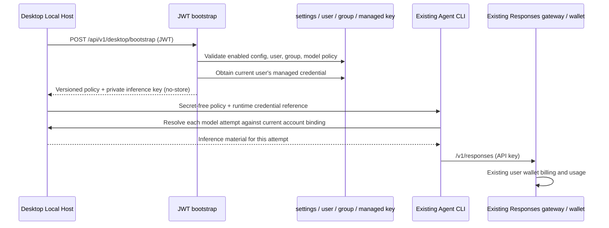

# Desktop Agent bootstrap（W3）

状态：2026-11-11 已完成服务端实现、代码复核和本地定向回归；正式发布状态以 CI 和生产发布记录为准。基线 `codex/desktop-managed-agent@d5555fb24e207250958965bfd227009870c8d5f0`。仅增加本地桌面接入，复用 JWT、网关、用户余额和 usage；不部署云端 Agent，不自动创建支付订单，不发付费探测请求。

## 所有者与边界



- 登录 JWT 与推理 Key 分开；客户端不能提交 user/group/key/base/enable 参数。
- bootstrap 原始 Key 只到 Host 内存，不进入 Renderer、普通 Provider JSON、任务快照或日志。客户端负责可信 origin 校验及账户 epoch 防迟到。
- 默认关闭。运营必须配置标准余额分组、与账户站点同源的 HTTPS `/v1` 网关地址、经过验证的一条 Responses 模型及完整能力、reasoning/输出预算。首片客户端拒绝 bootstrap 将推理材料导向另一个 origin；本地 HTTP loopback 只用于开发 fixture。
- `enabled=false` 是 bootstrap 准入开关，不是已发 Key 的全局撤销；Host 刷新到 disabled 后停止本机授权。立即撤销仍需停用凭据并使认证缓存失效；Agent 与生图工作台分别持有 Key，停用 Agent Key 不影响生图 Key。
- 主任务与标题、压缩、校验、子 Agent 共用授权模型；保留原执行器和权限语义，不自动切官方供应商。
- ready 表示静态配置和凭据可尝试执行，不保证此刻上游容量，不在 bootstrap 中试扣费。
- 本机退出清理本地凭据并阻断本机调用；不撤销该用户其他设备复用的 Agent 凭据。

## HTTP 合同

`POST /api/v1/desktop/bootstrap` 位于既有 JWT 用户路由组，保留原面板限流与审计。

严格 JSON body：`client_version`（1–128 字符）、`protocol_version: 1`、`platform: win32 | darwin`，可选 `installation_id`（诊断标识，非设备授权）。拒绝未知字段、null、重复字段、尾随 JSON、超限 body 和其他平台。版本不兼容返回 400，不创建 Key。

沿原 `{code:0,message:"success",data:...}` envelope。所有 handler 结果带 `Cache-Control: no-store`。HTTP 未认证与业务不可用分开。`data` 包含：

| 字段 | 规则 |
| --- | --- |
| schema_version | 固定 1 |
| config_revision | 当前服务端配置的稳定内容 hash；不是递增序号或秘密 |
| service_status | ready / disabled / not_configured / forbidden / credential_blocked |
| reason_code | 稳定机器码；ready 时为 ready |
| provider | 仅 ready；id=milorouter-managed，api_type=openai-responses，base_url |
| models | 仅 ready；恰好一条，下表完整策略 |
| selection_policy | 仅 ready；model_id、reasoning_level、max_output_tokens、auxiliary=inherit-main |
| credential | 仅 ready；id 为十进制字符串、key、scope（不透明受控标识）、expires_at（RFC3339 或 null） |

模型字段：`id, display_name, context_window, max_output_tokens, default_max_output_tokens, reasoning_levels, default_reasoning, supports_reasoning, supports_streaming, requires_mfjs_tool_schema, input:{text,image,video,audio,pdf}, output:{text}, supports_tool_call, supports_json_schema_output, supports_native_web_search, supports_mid_conversation_system`。全部布尔值显式存在；无 CEL/脚本/任意参数映射。

reasoning 枚举按强度顺序排列：`none,minimal,low,medium,high,xhigh,max`；必须非空、无重复，default 必须在其中。不支持 reasoning 时显式 `supports_reasoning=false, reasoning_levels=["none"], default_reasoning="none"`，客户端映射空对象。支持时由客户端固定映射到 Responses `reasoning.effort`，不做模型名推断。其中 `none` 沿用 ZCode 语义：不发送 `reasoning.effort`，使用上游既有默认，不承诺强制无思考。分组策略校验使用与客户端相同的请求形状：`none` 不带 effort，其他档位显式发送 effort；不把只针对显式 `none` 的分组映射误套到省略参数的请求。输出上限和默认预算均为正整数、默认不超过上限，上限小于上下文窗口；客户端执行预算 clamp，不能只显示而不执行。

配置/组/用户/模型失败不返回 provider、models、selection_policy、credential。reason_code 包括 disabled、configuration_missing、configuration_invalid、user_forbidden、group_unavailable、group_forbidden、model_forbidden、credential_disabled、credential_expired、credential_quota_exhausted、configuration_changed。

## 管理配置

`GET/PUT /api/v1/admin/desktop/config`：既有完整管理员边界，写入沿既有 step-up。只读写 `desktop_agent_config_v1` 一条 JSON settings，不加入公开 settings，不回写其他设置，无密钥。无此记录等价 disabled。

配置 `{enabled, group_id, base_url, model}`；关闭时允许保留完整配置。开启时要求模型能力完整、支持文本输入/文本输出/工具调用/流式、有效 active OpenAI 或 composite 标准余额组，模型命中该组白名单；每档 reasoning 不能被当前分组策略改写/降档/拒绝。运行 bootstrap 再次验证用户状态和组权限。模型能力由运营确认，不能从 `/v1/models` 名单猜测。首片管理入口为 API，尚无专用配置页面；通过受保护配置 API 写入，不要求普通桌面用户参与。

## 独立 Agent 凭据

用户确认：Agent 与生图工作台各用一把 Key，可共用 composite 标准余额分组，消费按 Key 区分。新增 nullable `api_keys.purpose`，新用途固定 `desktop_agent`，数据库以未删除 system Key 的 `(user_id,purpose)` 部分唯一索引保证身份。历史 image Key 的 purpose 保持 NULL，不领用、改名、换组或迁移其行；旧 name 唯一索引保留。

- 名称仅用于显示，幂等查找只认 purpose。保留名称冲突报错，不按名称领用历史 Key。
- 领取在数据库事务内锁定用户，再读当前用途；缺失时创建，存在则原样保留 key/status/quota/expiry。停用、过期、耗尽不得通过重复 bootstrap、通用编辑或软删除重新生成/复活。
- 仅可用 Key 允许同步配置组；事务内重验 active 用户、标准余额组及用户绑定权限，保证无权限不创建。配置变化时不返回旧 revision 的 ready，客户端重试取得最新策略；领取后再次核对用户、模型组和用户授权。ready 是当前验证快照，后续撤权由原有网关与缓存语义执行。
- 创建或改组提交成功后清认证正/负缓存和跨实例缓存；失败事务不触发成功失效。沿用既有失效实现，其 Redis 错误为 best effort，不能承诺 Redis 故障期间即时全局撤销。
- 通用列表（含 concurrency 排序）、详情及嵌套 usage 的管理元数据必须可靠加载；加载失败拒绝响应。DTO 对 desktop_agent 清除原始 Key；其他用户和历史 image Key 保持既有协议。
- 通用用户 Update/Delete 和管理员单 Key 改组拒绝 desktop_agent；批量替换用户分组跳过 desktop_agent，保持用户 Key 和历史 image Key 的原有迁移语义。系统 Key 类型查询失败一律拒绝继续。管理员通过桌面配置驱动 Agent 组，未来明确撤销 API 保持 purpose 身份并清缓存。
- purpose 是管理身份，不新增网关用途/模型权限。共享 composite 组仍保留原有网关权限；不能宣称用途值可限制持有者调用图片协议。
- installation_id 只是诊断信息。首片是每用户一把 Agent Key、该用户设备间复用；没有设备级撤销或轮换合同。

## 凭据时序与实现位置

```mermaid
sequenceDiagram
  participant B as Bootstrap service
  participant K as APIKeyService
  participant D as PostgreSQL
  participant C as Auth L1 / Redis / pubsub
  B->>B: Validate config + user + model/group policy
  B->>K: GetDesktopAgentCredential(user, group)
  K->>D: Begin; lock user; share-lock config and group
  D->>D: Check binding; share-lock explicit grant if required
  D->>D: Lock purpose row; create once or sync usable key group
  D-->>K: Commit; final key and changed flag
  K->>C: Invalidate only after successful create / group sync
  K-->>B: Independent desktop_agent credential
  B->>B: Re-read config and authorization; reject stale result
  B-->>B: Build ready DTO or omit all inference material
```

| 实现 | 位置 |
| --- | --- |
| 稳定用途列与唯一索引 | backend/migrations/256_desktop_agent_key_purpose.sql |
| 数据库领取与管理元数据 | backend/internal/repository/api_key_managed.go |
| 唯一 provider 与提交后缓存失效 | backend/internal/service/api_key_desktop_agent.go |
| 完整 bootstrap 策略与变更复查 | backend/internal/service/desktop_agent.go |
| 用户编辑/删除与管理员改组边界 | backend/internal/service/api_key_service.go、admin_group.go；批量迁移条件在 repository/api_key_repo.go |
| 普通详情、各种排序与嵌套用量 | repository/api_key_repo.go、usage_log_repo_query.go；dto/mappers.go 清除 Agent 原始 Key |
| 真实 provider 装配 | handler/wire.go、cmd/server/wire_gen.go |

迁移随既有启动迁移器执行。此版本应用依赖迁移 256，不能只替换代码而跳过迁移。迁移为增量列/索引，不回填、不重写历史 image/user 行；发布清单的 schema epoch 升至 4，维持 backup-required。回滚代码时即使保留新增列/索引，旧二进制仍不具备新用途保护，不可据此宣称安全的混合版本滚动部署。正式启用前应让所有对外 API 实例完成同版本升级。

## 回归验收

2026-11-11 已执行并通过：

- `go test -tags=unit ./internal/service ./internal/handler ./internal/handler/dto ./internal/server/routes ./internal/repository -run 'TestDesktop|Test.*APIKey|TestUsageLog' -count=1`。
- `go test -tags=integration ./internal/repository -run 'TestDesktopAgent|TestMigration256|TestAPIKeyRepoSuite|TestGetByKeyForAuthCarries' -count=1 -v`：真实临时 PostgreSQL 18.1、Redis 8.4，32 并发领取、独立用途唯一性、旧数据库升级前后逐行对账、停用/过期/耗尽保留、权限拒绝/撤权、组同步与旧配置拒绝、批量换组隔离、真实 provider→bootstrap、详情/普通/group/concurrency 排序/usage 脱敏及既有 Key 仓储与网关投影回归。
- service 单测验证事务成功后才清 L1 正/负缓存、Redis 删除及跨实例通知调用；失败事务不触发失效。`go test -tags=integration ./internal/repository -run '^TestDesktopAgentManagedKeyGroupSyncInvalidatesRealRedisAuthCache$' -count=1 -v` 通过（6.571s）：实际填入旧组认证 L2，领取同步新组后 L2 已删除、pubsub 收到失效 hash，下一次同 Key 认证读到新组。
- Wire 生成、相关五包 `go vet`、`CGO_ENABLED=0 go build -trimpath -o /tmp/sub2api-desktop-w3 ./cmd/server`、`git diff --check`。
- 复核补充：`none` 按客户端省略 effort 的实际请求校验，显式其他档位仍受分组策略约束；相关单测已通过。真实 PostgreSQL/Redis 的上述领取、迁移、缓存和旧 Key 仓储用例再次通过。网页密钥列表对已脱敏的托管 Key 显示占位并隐藏复制入口；密钥列表和批量编辑的 33 项前端测试通过。

严格配置/请求、JWT/Admin/step-up 边界、缺省关闭、能力/预算、非 ready 无秘密、用户归属、credits 超过 JS 安全整数、legacy 零 credits 仍有 actual_cost 均有定向回归。SQLite 测试夹具显式补迁移 249/256 管理列，生产查询失败时仍拒绝响应。

未以这些测试替代：真实生产 JWT、真实上游工具调用/计费、SSE/网络恢复、最终 macOS/Windows 安装包。自动测试不发送真实付费请求或创建支付订单；功能默认关闭，部署本身不写入生产模型/分组配置。

既有 usage DTO 保留 number 字段，新增 `charge_credits_string`、`credits_per_usd_string`，完整 int64 的十进制字符串，无账本改动。legacy 的字符串零仍可能伴随正 actual_cost，不能当作免费。当前 Key 过滤只覆盖同一用户的 Agent 用途 Key 及复用它的设备，不承诺跨轮换总消费或每任务账单。

管理员删除整个用户、禁用/删除分组仍按既有生命周期处理；purpose 不是额外网关权限。显式设备级撤销、轮换、托管 Key 管理页面，以及 Redis 故障期间的强一致撤销不在本片范围。
