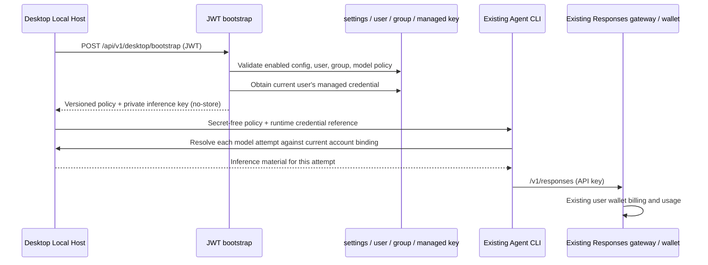
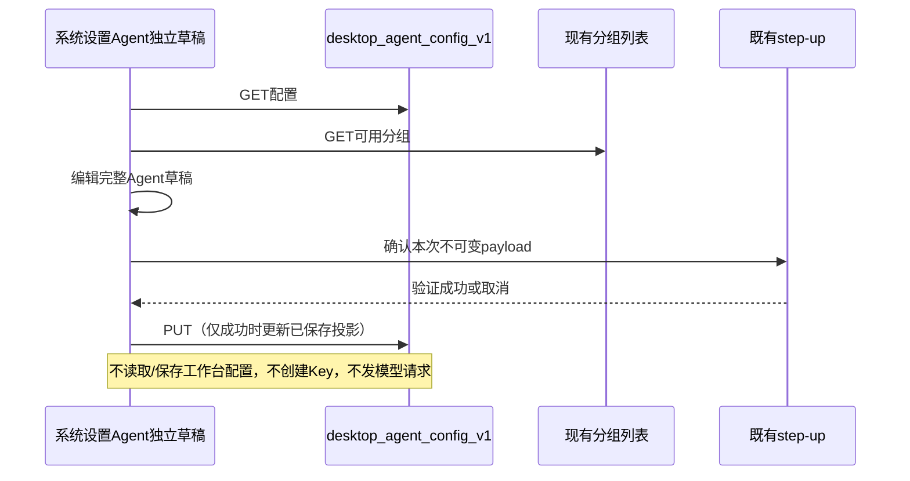

# Desktop Agent bootstrap（W3）

状态：2026-11-12 已完成独立系统 Agent 配置页面与本人托管 Key 可读调整；前版已发布为 `0.2.21-ds.3`，本轮正式发布状态以 CI 和发布记录为准。本轮基线 `codex/desktop-managed-agent@2c95996ca65b209632e6f418e6b2ff2493e51cac`，早期后端实施基线为 `d5555fb24e207250958965bfd227009870c8d5f0`。复用 JWT、网关、用户余额和 usage；不部署云端 Agent，不自动创建支付订单，不发付费探测请求。

## 所有者与边界



- 登录 JWT 与推理 Key 分开；客户端不能提交 user/group/key/base/enable 参数。
- 桌面 bootstrap 将 Key 下发给本机 Host，客户端不将其写入 Renderer、普通 Provider JSON、任务快照或日志。用户可在已登录网站的本人 Key 列表/详情查看并复制 Agent Key，与既有工作台 Key 一致；这不扩大跨用户或公开访问权限。
- 默认关闭。运营必须配置标准余额分组、与账户站点同源的 HTTPS `/v1` 网关地址、经过验证的一条 Responses 模型及完整能力、reasoning/输出预算。首片客户端拒绝 bootstrap 将推理材料导向另一个 origin；本地 HTTP loopback 只用于开发 fixture。
- `enabled=false` 是 bootstrap 准入开关，不是已发 Key 的全局撤销；Host 刷新到 disabled 后停止本机授权。立即撤销仍需停用凭据并使认证缓存失效；Agent 与生图工作台分别持有 Key，停用 Agent Key 不影响生图 Key。
- 主任务与标题、压缩、校验、子 Agent 共用授权模型；保留原执行器和权限语义，不自动切官方供应商。
- ready 表示静态配置和凭据可尝试执行，不保证此刻上游容量，不在 bootstrap 中试扣费。
- 本机退出清理本地凭据并阻断本机调用；不撤销该用户其他设备复用的 Agent 凭据。

## HTTP 合同

`POST /api/v1/desktop/bootstrap` 位于既有 JWT 用户路由组，保留原面板限流与审计。

严格 JSON body：`client_version`（1–128 字符）、`protocol_version: 1`、`platform: win32 | darwin`，可选 `installation_id`（诊断标识，非设备授权）。拒绝未知字段、null、重复字段、尾随 JSON、超限 body 和其他平台。版本不兼容返回 400，不创建 Key。

沿原 `{code:0,message:"success",data:...}` envelope。所有 handler 结果带 `Cache-Control: no-store`。HTTP 未认证与业务不可用分开。`data` 包含：

| 字段 | 规则 |
| --- | --- |
| schema_version | 固定 1 |
| config_revision | 当前服务端配置的稳定内容 hash；不是递增序号或秘密 |
| service_status | ready / disabled / not_configured / forbidden / credential_blocked |
| reason_code | 稳定机器码；ready 时为 ready |
| provider | 仅 ready；id=milorouter-managed，api_type=openai-responses，base_url |
| models | 仅 ready；恰好一条，下表完整策略 |
| selection_policy | 仅 ready；model_id、reasoning_level、max_output_tokens、auxiliary=inherit-main |
| credential | 仅 ready；id 为十进制字符串、key、scope（不透明受控标识）、expires_at（RFC3339 或 null） |

模型字段：`id, display_name, context_window, max_output_tokens, default_max_output_tokens, reasoning_levels, default_reasoning, supports_reasoning, supports_streaming, requires_mfjs_tool_schema, input:{text,image,video,audio,pdf}, output:{text}, supports_tool_call, supports_json_schema_output, supports_native_web_search, supports_mid_conversation_system`。全部布尔值显式存在；无 CEL/脚本/任意参数映射。

reasoning 枚举按强度顺序排列：`none,minimal,low,medium,high,xhigh,max`；必须非空、无重复，default 必须在其中。不支持 reasoning 时显式 `supports_reasoning=false, reasoning_levels=["none"], default_reasoning="none"`，客户端映射空对象。支持时由客户端固定映射到 Responses `reasoning.effort`，不做模型名推断。其中 `none` 沿用 ZCode 语义：不发送 `reasoning.effort`，使用上游既有默认，不承诺强制无思考。分组策略校验使用与客户端相同的请求形状：`none` 不带 effort，其他档位显式发送 effort；不把只针对显式 `none` 的分组映射误套到省略参数的请求。输出上限和默认预算均为正整数、默认不超过上限，上限小于上下文窗口；客户端执行预算 clamp，不能只显示而不执行。

配置/组/用户/模型失败不返回 provider、models、selection_policy、credential。reason_code 包括 disabled、configuration_missing、configuration_invalid、user_forbidden、group_unavailable、group_forbidden、model_forbidden、credential_disabled、credential_expired、credential_quota_exhausted、configuration_changed。

## 管理配置

`GET/PUT /api/v1/admin/desktop/config`：既有完整管理员边界，写入沿既有 step-up。只读写 `desktop_agent_config_v1` 一条 JSON settings，不加入公开 settings，不回写其他设置，无密钥。无此记录等价 disabled。

配置 `{enabled, group_id, base_url, model}`；关闭时允许保留完整配置。开启时要求模型能力完整、支持文本输入/文本输出/工具调用/流式、有效 active OpenAI 或 composite 标准余额组，模型命中该组白名单；每档 reasoning 不能被当前分组策略改写/降档/拒绝。运行 bootstrap 再次验证用户状态和组权限。模型能力由运营确认，不能从 `/v1/models` 名单猜测。管理入口为 **系统设置 → Agent**（`/admin/settings#agent`），复用受保护配置 API，独立保存，不要求普通桌面用户参与。

## 2026-11-12：独立系统 Agent 配置合同（用户最终决定）

产品规则先于实现：在现有 `/admin/settings` 系统设置新增与通用、网关等并列的 **Agent** 栏，深链接为 `/admin/settings#agent`。当前所有独立 Agent 配置统一在此管理，不放入工作台配置、不新增第二份设置来源，也不从图片设置隐式联动。页面只通过 `GET/PUT /admin/desktop/config` 读写原 `desktop_agent_config_v1`；不混进通用系统设置全量保存。

- **单一所有者**：服务端setting是已保存事实；独立Agent组件拥有加载快照、唯一未提交草稿和保存方法。通用设置、工作台、图片存储的读取/保存各自独立，Agent栏不出现通用保存按钮；不能因页面外层form/Enter冒泡意外提交通用设置。离开/重新加载期间的迟到读取不能覆盖后续草稿，保存中冻结，二次验证完成前不能改变本次payload。
- **集中管理**：当前服务开关、分组、网关、模型ID/展示名、reasoning档位/默认档、上下文/模型输出上限/默认输出预算、全部输入/输出与工具能力、JSON schema/native web search/mid-system/MFJS能力均在此完整维护。未来Agent独立设置沿此入口扩展；本轮不发明未实现的设备撤销、支付或执行配置。
- **分组**：只可选择active、standard余额计费OpenAI/composite分组；已保存的失效选择要可见且给出修正提示，不能静默换组。可以手动选择与工作台相同的聚合分组，但不读取图片配置、不提供跨区快捷写入或联动；分组权限仍由现有用户AllowedGroups/公开组限制判断。
- **模型与预算**：管理员填写真实模型和能力，不按模型名猜测。必须支持文本输入/输出、工具和stream；上下文与预算为安全正整数、输出小于上下文、默认不超过上限。所有bool显式保存，reasoning按既有none→minimal→low→medium→high→xhigh→max顺序无重复，默认属于候选；none仍省略effort。服务端继续最终验证分组白名单和思考策略，不绕过验证或静默替换模型。
- **网关**：默认账户站点同源HTTPS `/v1`；保存校验无query/hash/userinfo、精确/v1路径，并提醒桌面要求与其账户站点同源。独立站点/反代管理地址可以明确填写实际客户端账户站点，不把浏览器地址误当服务器固定域名。本轮页面不发付费探测、不调用bootstrap、不创建Key。
- **加载与保存**：完整管理员GET/PUT，复用已有step-up。配置/分组加载失败禁用保存，不能以默认值覆盖；取消二次验证不保存不提示成功。成功采用返回的已保存配置，失败保留草稿并展示安全错误；刷新和保存互斥，同一payload二次验证重试一次。首次未配置明确保持关闭，模型留待管理员填写，不臆造真实参数。
- **关闭**：完整有效配置关闭时保留所有字段；关闭允许在现有值无效时显式提交仅 `{enabled:false}`，界面须明确这是只关闭而非保存未提交草稿，不静默丢失配置。关闭只阻断后续bootstrap，不撤销已发Key；已连接桌面需要重连应用配置，非立即全设备撤权开关。
- **Key可读且托管**：用户明确允许本人网站列表、详情、使用配置、复制和CCSwitch取得原始Agent Key，与现有工作台一致；取消DTO按desktop_agent特殊置空，不额外增加匿名/跨用户入口。现有本人归属权限保持，普通Key读取缓存合同沿用。Agent仍禁止通用编辑/改名/状态/限额/有效期/分组变更和删除，管理员单Key改组继续拒绝；用途幂等领取、不复活停用/过期Key、组同步与缓存失效不改。桌面Renderer仍不接触推理Key，不把网站可读等同于桌面落盘或日志可读。



验收覆盖系统设置Agent标签与深链接/键盘切换、通用保存隔离、全部字段保存重载、工作台无Agent入口、不适用/失效组、模型/预算/reasoning非法、初始关闭、加载失败禁止保存、保存失败保留草稿、step-up成功/取消、刷新与保存互斥、卸载迟到结果；本人Key可复制/使用/导入且仍不可修改删除/他人不可读。实际Vue页面用本地合成管理API做桌面/375px中英文、暗色与布局验收；不使用生产账户、不部署/发布、不付费调用。

### 配置和发布顺序

1. 发布包含本轮前端资源和后端 DTO 的同一版本。只替换旧前端所连接的后端，不会出现新增标签。本轮没有新增数据库迁移，仍依赖前版迁移 256；不修改已有工作台配置或 Key。
2. 打开 **系统设置 → Agent**，选择有效的标准余额计费 OpenAI/聚合分组。需要共用工作台分组时由管理员手动选择同一组，保持两把 Key 独立；确认目标用户允许使用该组。
3. 填写与桌面账户站点同源的 HTTPS `/v1`，配置一个经过验证的 Responses 模型，填写完整能力、上下文与输出预算、推理档位。初次无配置保持关闭，页面不会猜测参数。
4. 开启并“保存 Agent 配置”，完成既有二次验证。保存只修改 Agent setting，不领取 Key，不发模型请求；普通“保存设置”不会覆盖它。
5. 桌面重新连接后读取策略，在首次成功 bootstrap 时幂等领取本人 Agent Key；后续复用，不重复创建。本人网站 API 密钥页可以查看、复制、使用及 CCSwitch 导入，系统托管写保护继续生效。修改分组后也在后续 bootstrap 同步该用户可用 Agent Key，并非立即改写所有用户 Key。

当前“关闭服务”仅控制 bootstrap，不代表立即撤销所有已发凭据；不改动原工作台、余额账本、网关或支付流程。上线后的真实登录、工具调用和实际余额/usage 对账仍需由用户安排联调，本轮只使用本地夹具。

## 独立 Agent 凭据

用户确认：Agent 与生图工作台各用一把 Key，可共用 composite 标准余额分组，消费按 Key 区分。新增 nullable `api_keys.purpose`，新用途固定 `desktop_agent`，数据库以未删除 system Key 的 `(user_id,purpose)` 部分唯一索引保证身份。历史 image Key 的 purpose 保持 NULL，不领用、改名、换组或迁移其行；旧 name 唯一索引保留。

- 名称仅用于显示，幂等查找只认 purpose。保留名称冲突报错，不按名称领用历史 Key。
- 领取在数据库事务内锁定用户，再读当前用途；缺失时创建，存在则原样保留 key/status/quota/expiry。停用、过期、耗尽不得通过重复 bootstrap、通用编辑或软删除重新生成/复活。
- 仅可用 Key 允许同步配置组；事务内重验 active 用户、标准余额组及用户绑定权限，保证无权限不创建。配置变化时不返回旧 revision 的 ready，客户端重试取得最新策略；领取后再次核对用户、模型组和用户授权。ready 是当前验证快照，后续撤权由原有网关与缓存语义执行。
- 创建或改组提交成功后清认证正/负缓存和跨实例缓存；失败事务不触发成功失效。沿用既有失效实现，其 Redis 错误为 best effort，不能承诺 Redis 故障期间即时全局撤销。
- 通用列表（含 concurrency 排序）、详情及嵌套 usage 的管理元数据必须可靠加载；加载失败拒绝响应。2026-11-12 用户确认 Agent Key 与工作台 Key 一样可读：沿既有受认证和用户归属保护的 Key DTO 返回原始值，不再按 desktop_agent 特殊置空；公开端点、日志和跨用户访问没有新增权限。
- 通用用户 Update/Delete 和管理员单 Key 改组拒绝 desktop_agent；批量替换用户分组跳过 desktop_agent，保持用户 Key 和历史 image Key 的原有迁移语义。系统 Key 类型查询失败一律拒绝继续。管理员通过桌面配置驱动 Agent 组，未来明确撤销 API 保持 purpose 身份并清缓存。
- purpose 是管理身份，不新增网关用途/模型权限。共享 composite 组仍保留原有网关权限；不能宣称用途值可限制持有者调用图片协议。
- installation_id 只是诊断信息。首片是每用户一把 Agent Key、该用户设备间复用；没有设备级撤销或轮换合同。

## 凭据时序与实现位置

```mermaid
sequenceDiagram
  participant B as Bootstrap service
  participant K as APIKeyService
  participant D as PostgreSQL
  participant C as Auth L1 / Redis / pubsub
  B->>B: Validate config + user + model/group policy
  B->>K: GetDesktopAgentCredential(user, group)
  K->>D: Begin; lock user; share-lock config and group
  D->>D: Check binding; share-lock explicit grant if required
  D->>D: Lock purpose row; create once or sync usable key group
  D-->>K: Commit; final key and changed flag
  K->>C: Invalidate only after successful create / group sync
  K-->>B: Independent desktop_agent credential
  B->>B: Re-read config and authorization; reject stale result
  B-->>B: Build ready DTO or omit all inference material
```

| 实现 | 位置 |
| --- | --- |
| 稳定用途列与唯一索引 | backend/migrations/256_desktop_agent_key_purpose.sql |
| 数据库领取与管理元数据 | backend/internal/repository/api_key_managed.go |
| 唯一 provider 与提交后缓存失效 | backend/internal/service/api_key_desktop_agent.go |
| 完整 bootstrap 策略与变更复查 | backend/internal/service/desktop_agent.go |
| 用户编辑/删除与管理员改组边界 | backend/internal/service/api_key_service.go、admin_group.go；批量迁移条件在 repository/api_key_repo.go |
| 普通详情、各种排序与嵌套用量 | repository/api_key_repo.go、usage_log_repo_query.go；dto/mappers.go 沿本人权限返回原始 Key 与系统托管标识 |
| 独立管理入口与保存隔离 | frontend/src/views/admin/SettingsView.vue、components/admin/settings/AgentSettings.vue |
| 类型化 API 与完整字段校验 | frontend/src/api/admin/desktopAgent.ts、utils/desktopAgentConfig.ts |
| 真实 provider 装配 | handler/wire.go、cmd/server/wire_gen.go |

迁移随既有启动迁移器执行。此版本应用依赖迁移 256，不能只替换代码而跳过迁移。迁移为增量列/索引，不回填、不重写历史 image/user 行；发布清单的 schema epoch 升至 4，维持 backup-required。回滚代码时即使保留新增列/索引，旧二进制仍不具备新用途保护，不可据此宣称安全的混合版本滚动部署。正式启用前应让所有对外 API 实例完成同版本升级。

## 回归验收

### 2026-11-12 本轮结果

前端命令在 `frontend/`，Node 固定为 24.14.0。当前本机 pnpm 入口存在 overrides/lock 校验不兼容，未修改依赖和锁文件；直接使用仓库已安装的对应工具，运行 build 的全部阶段（国际化检查、`vue-tsc -b`、Vite build）。

- **202/202 前端回归通过**：SettingsView、AgentSettings、类型化 API、配置校验、KeysView、UseKeyModal、BulkEditKeysModal 与三项国际化测试文件。命令：`node node_modules/vitest/vitest.mjs run src/views/admin/__tests__/SettingsView.spec.ts src/components/admin/settings/__tests__/AgentSettings.spec.ts src/api/__tests__/admin.desktopAgent.spec.ts src/utils/__tests__/desktopAgentConfig.spec.ts src/views/user/__tests__/KeysView.spec.ts src/components/keys/__tests__/UseKeyModal.spec.ts src/components/keys/__tests__/BulkEditKeysModal.spec.ts src/i18n/__tests__/localeKeyCompleteness.spec.ts src/i18n/__tests__/localesMessageCompile.spec.ts src/i18n/__tests__/localesNoKeyCollision.spec.ts`。既有 SettingsView jsdom/stub 的 stderr 提示仍在，不将其描述为零 warning。
- `node node_modules/vue-tsc/bin/vue-tsc.js -b` 通过；`node node_modules/eslint/bin/eslint.js .` 通过（0 errors、1 项既有 UsageView 测试未使用变量 warning）；`node node_modules/vite/bin/vite.js build` 通过（15.59s，保留既有大 chunk warning）。日志在本地 ignored `output/research/agent-settings-final-{tests,typecheck,lint,build}-2026-11-12.log`。
- 后端 cwd 为 `backend/`，三条定向命令均通过：`go test ./internal/handler/dto -run 'TestDesktop|TestAPIKeyFromService' -count=1`；`go test -tags=unit ./internal/service -run 'TestDesktopManagedPublicEditsAndDeletesCannotReviveOrRecreate|TestDesktopManagedMetadataFailureBlocksGenericMutation' -count=1`；`go test -tags=integration ./internal/repository -run '^TestDesktopAgentManagedKeyConcurrentEnsureAndMetadata$' -count=1 -v`。集成使用临时 PostgreSQL 18.1 / Redis 8.4，覆盖 32 并发领取、本人原值读取与系统元数据；服务层覆盖通用修改/删除不能复活托管 Key，以及元数据失败拒绝修改。
- **真实浏览器本地验收 39/39 通过**：完整 SettingsView 和真实路由、组件及 step-up 对话框，管理 API 使用合成夹具，Vite 代理指向不可达本地地址防误连生产。覆盖深链接/键盘/Enter、完整保存与重读、保存隔离、step-up取消/成功且payload一致、请求失败、失效组、显式仅关闭、完整关闭配置保留字段，以及 375px 中英文明暗四种布局；无页面异常、外部/工作台/bootstrap/模型请求。结果和可重复 runner 在本地 ignored `output/playwright/agent-settings-2026-11-12/{results.json,run.py}`，截图同目录 `desktop-zh.png`、`desktop-en-dark.png` 和 `mobile-{zh,en}-{light,dark}.png`。初轮夹具中支付/邮件响应形状不足导致隐藏面板提示，补齐夹具后重跑，未为消除假错误修改产品代码。
- ZCode 本轮仅同步规格与交接文档；`pnpm typecheck` 和 `pnpm lint` 均通过，Lint 保留 84 项既有 warning、0 errors。两仓库 `git diff --check` 通过，ZCode 两份文档经 oxfmt 格式化。

本轮没有真实生产凭据、支付或付费推理；不把本地管理页验收等同于已完成生产配置。

### 前版历史结果

2026-11-11 历史验收（当时 Key 脱敏规则已由 11 月 12 日的本人可读规则替代）：

- `go test -tags=unit ./internal/service ./internal/handler ./internal/handler/dto ./internal/server/routes ./internal/repository -run 'TestDesktop|Test.*APIKey|TestUsageLog' -count=1`。
- `go test -tags=integration ./internal/repository -run 'TestDesktopAgent|TestMigration256|TestAPIKeyRepoSuite|TestGetByKeyForAuthCarries' -count=1 -v`：真实临时 PostgreSQL 18.1、Redis 8.4，32 并发领取、独立用途唯一性、旧数据库升级前后逐行对账、停用/过期/耗尽保留、权限拒绝/撤权、组同步与旧配置拒绝、批量换组隔离、真实 provider→bootstrap、详情/普通/group/concurrency 排序/usage 脱敏及既有 Key 仓储与网关投影回归。
- service 单测验证事务成功后才清 L1 正/负缓存、Redis 删除及跨实例通知调用；失败事务不触发失效。`go test -tags=integration ./internal/repository -run '^TestDesktopAgentManagedKeyGroupSyncInvalidatesRealRedisAuthCache$' -count=1 -v` 通过（6.571s）：实际填入旧组认证 L2，领取同步新组后 L2 已删除、pubsub 收到失效 hash，下一次同 Key 认证读到新组。
- Wire 生成、相关五包 `go vet`、`CGO_ENABLED=0 go build -trimpath -o /tmp/sub2api-desktop-w3 ./cmd/server`、`git diff --check`。
- 复核补充：`none` 按客户端省略 effort 的实际请求校验，显式其他档位仍受分组策略约束；相关单测已通过。真实 PostgreSQL/Redis 的上述领取、迁移、缓存和旧 Key 仓储用例再次通过。当时网页对已脱敏 Key 隐藏复制，密钥列表和批量编辑的 33 项前端测试通过；11 月 12 日恢复原值后，既有复制、使用与 CCSwitch 入口可继续使用。

严格配置/请求、JWT/Admin/step-up 边界、缺省关闭、能力/预算、非 ready 无秘密、用户归属、credits 超过 JS 安全整数、legacy 零 credits 仍有 actual_cost 均有定向回归。SQLite 测试夹具显式补迁移 249/256 管理列，生产查询失败时仍拒绝响应。

未以这些测试替代：真实生产 JWT、真实上游工具调用/计费、SSE/网络恢复、最终 macOS/Windows 安装包。自动测试不发送真实付费请求或创建支付订单；功能默认关闭，部署本身不写入生产模型/分组配置。

既有 usage DTO 保留 number 字段，新增 `charge_credits_string`、`credits_per_usd_string`，完整 int64 的十进制字符串，无账本改动。legacy 的字符串零仍可能伴随正 actual_cost，不能当作免费。当前 Key 过滤只覆盖同一用户的 Agent 用途 Key 及复用它的设备，不承诺跨轮换总消费或每任务账单。

管理员删除整个用户、禁用/删除分组仍按既有生命周期处理；purpose 不是额外网关权限。显式设备级撤销、轮换、专用Key生命周期管理，以及 Redis 故障期间的强一致撤销不在本片范围。
