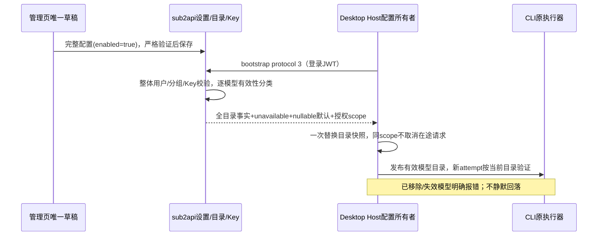
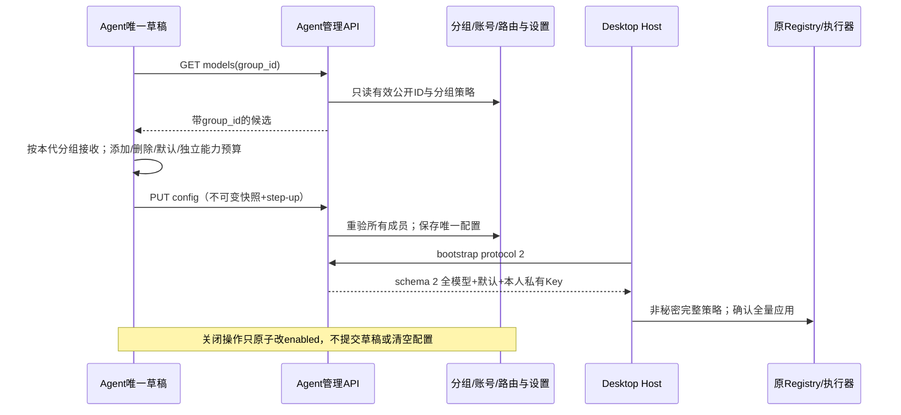
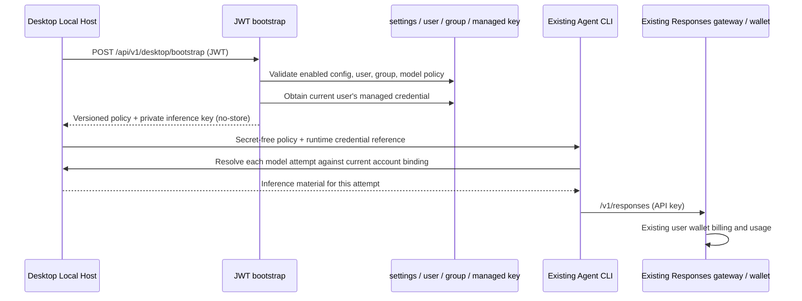
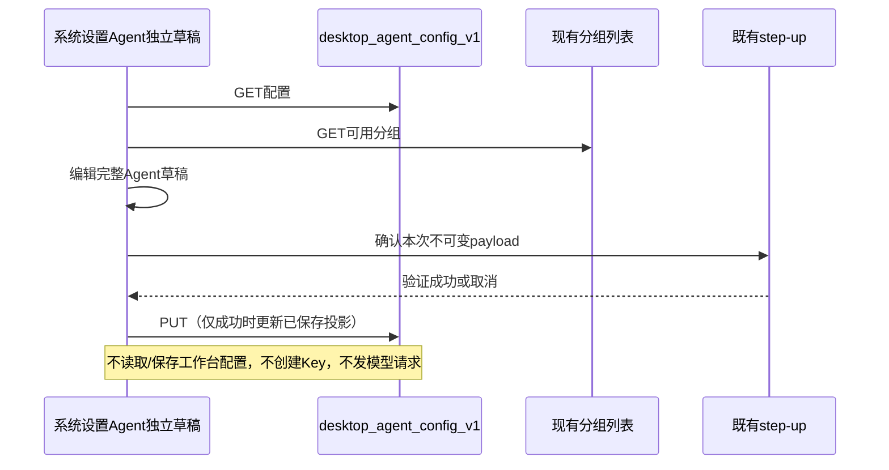

# Desktop Agent bootstrap（W3）

## 2026-11-13：桌面客户端配置与登录整理

当前增量规则见 [桌面集成合同](./DESKTOP_CLIENT_INTEGRATION.md)、[浏览器授权合同](./DESKTOP_BROWSER_AUTH.md)、[前端体验合同](./DESKTOP_CLIENT_EXPERIENCE.md)及[官方模型档案](./DESKTOP_MODEL_PROFILES.md)。本节新规则覆盖下文历史提案：保留 protocol 1/2/3 线协议；旧随填能力不再当作模板，已知 ID 按官方档案和执行器限制校准，未知别名须显式关联；高级声明必须明确启用覆盖。`default_max_output_tokens` 准确显示为单次输出上限。本人仅可轮换 active Key，disabled 仅完整管理员按现有 step-up 规则恢复；不改变普通Key、生图Key、原钱包与网关计费。授权登录使用外部浏览器PKCE，账户token仍复用原账户会话，未增加设备级推理授权。

本轮实现范围、验证证据、发布顺序与尚未完成的验收见 [交付说明](./DESKTOP_CLIENT_IMPLEMENTATION.md)。

### 兼容客户端的会话信号转发

网关已识别 `x-session-id` 等显式会话头；向普通 OpenAI API Key 上游转发时，若没有已转发的 `session_id` 或 `conversation_id`，应将同一已识别信号补到 `session_id`，同时保留同值 `x-session-id` 以兼容过滤下划线头的反向代理，避免第二层兼容网关丢失稳定的会话身份。复用现有入站会话提取顺序，只转发会话级信号，不从每次变化的 request/query ID 构造，不更改请求体或注入缓存键。普通和透传 Responses 路径使用同一规则；OAuth/Codex 继续原有会话隔离，不能把原始别名直接透传出去。

验收覆盖两条转发路径、大小写与已识别别名、已有规范头优先、无会话不凭空补值、请求内容变化后内层会话稳定，以及 OAuth 原隔离行为。该修正不保证供应商的缓存命中，也不消除本站回接时的逐层调度与计费；内部复用供应商应通过账号多分组关联完成。

## 2026-11-12：目录刷新 v3 与配置页收口（当前合同）

本节替代下文历史“连接开关/关闭 Agent 连接”的管理界面及 protocol 2 新客户端规则；protocol 1/2 的请求与响应合同保持兼容。未部署、未发真实推理请求或支付。源码验证结果见本节末尾。

- **管理规则**：系统设置 → Agent 仅维护分组、网关、模型目录、能力和默认模型，不展示“允许连接”或“关闭连接”。完整有效保存携带 `enabled:true`，保存前仍逐项严格校验全部模型，不能以空配置启用。旧 `enabled` 字段和专用 disable API 保留兼容；首次无配置明确为“尚未配置”，旧完整但 `enabled:false` 明确为“尚未发布，保存后启用”，不能显示已启用。配置开关不承诺关闭已有 Key 或停止已运行的 Agent。
- **运行目录规则**：v3 将已保存模型与当前组目录、白名单、推理策略逐项验证。单模型失效进入 `unavailable_models`，其他模型继续可用。允许 `ready + models:[]`，表达账户/分组/凭据正常但当前无可用模型。默认模型失效时 `selection_policy.default:null`，不得偷偷切到另一个模型。管理保存保持整体严格拒绝，不自动删除持久模型配置。
- **失败边界**：组不存在/停用、用户无权限、Key停用/过期/耗尽仍整体 nonready；分组/目录/数据库的读取失败返回 HTTP 503，不能冒充成功空目录。新客户端暂时网络失败保留上次成功快照，明确失效事实则按最新事实处理。相同 `config_revision` 也须读取全部响应状态：hash不包含组内部路由、用户和Key状态。
- **凭据边界**：`authorization_scope` 为 SHA256(规范 JSON `{group_id,base_url,key_id}`)，不含模型目录、能力、展示名或默认模型；改目录不得废弃在途请求，仅分组/网关/凭据身份变化才切换授权边界。它是客户端竞态隔离标识，不是网关授权令牌。Key照常使用现有余额/分组策略，不增加按 Agent 模型目录拦截的网关规则。

`POST /api/v1/desktop/bootstrap` 新增 `protocol_version:3`，返回 schema 3。ready 的精确增量合同：

```json
{
  "schema_version": 3,
  "config_revision": "saved-config-sha256",
  "service_status": "ready",
  "reason_code": "ready",
  "provider": {"id":"milorouter-managed","api_type":"openai-responses","base_url":"https://account.example.test/v1"},
  "models": [],
  "unavailable_models": [{"model_id":"configured-model","display_name":"Configured model","reason_code":"model_unavailable"}],
  "selection_policy": {"default":null,"auxiliary":"inherit-main"},
  "credential": {"id":"123","key":"private-current-user-credential","scope":"desktop_agent","expires_at":null,"authorization_scope":"authorization-sha256"}
}
```

`models` 与 `unavailable_models` 在 ready 时始终是数组；前者保留原完整模型策略。单模型原因包括 `model_unavailable`（目录/白名单失效）及 `reasoning_policy_changed`（组档位发生改写/拒绝）。默认模型仍有效时 `selection_policy.default` 为 `{model_id,reasoning_level,max_output_tokens}`；`auxiliary` 始终 `inherit-main`，不额外选择辅助模型。nonready 不返回 provider/models/unavailable_models/selection_policy/credential。v3首次零配置为 `not_configured/configuration_missing`；历史完整配置关闭仍为 `disabled/disabled`。protocol 1/2 继续整体严格校验、原 selection_policy 形状、不增加 authorization_scope/unavailable_models。



验收场景：单模型下架保留其余模型；默认下架得到null；全下架仍ready空目录；目录读取失败503且无凭据泄露；同revision组策略变化仍生效；目录/能力/默认变化scope稳定、组/网关/KeyID变化scope改变；旧protocol1/2保持整体拒绝；未配置页不能提交空启用、旧关闭配置保存后启用；step-up/迟到响应/草稿隔离保留。

本轮本地验证：

| 范围 | 执行与结果 |
| --- | --- |
| Go 行为 | `go test -p 2 -tags=unit ./internal/service ./internal/handler ./internal/server/routes -run 'TestDesktopAgent' -count=1` 三包通过，包含v3失效隔离、nullable默认、同revision重验、scope边界、暂时读取失败与旧协议兼容 |
| Server 编译 | `go test -p 2 ./cmd/server -run '^$'` 通过，仅编译/无匹配测试 |
| 前端回归 | 7文件148项通过：AgentSettings(30)、admin.desktopAgent API、desktopAgentConfig helper、SettingsView、localeKeyCompleteness、localesNoKeyCollision、localesMessageCompile |
| 完整类型检查 | 从frontend执行 `node node_modules/vue-tsc/bin/vue-tsc.js -b` 通过 |
| 完整Lint | 从frontend执行 `node node_modules/eslint/bin/eslint.js .` 通过，保留既有UsageView.spec.ts未使用formatLocalDate的1项warning（0 errors） |
| 差异检查 | `git diff --check` 通过 |

前端测试从frontend使用 `node node_modules/vitest/vitest.mjs run` 加上述7个实际路径执行。SettingsView夹具仍输出既有router-link/watch/jsdom请求诊断，全部断言通过；没有将这些提示记为无告警。未进行生产修改、付费请求、真实账号联调、数据库迁移或本轮真实浏览器验收。管理页收口保留原Select、卡片和step-up交互；测试包含中英文与真实Select键盘选择。

## 2026-11-12 追加合同：按组选择多个模型与保留配置停用

本节为当前用户修正规则，替代下文历史的“单模型手输 ID”与“仅 `{enabled:false}` 清空配置”交互。基线 `3844d81b2`；本轮经复核后按用户授权发布，真实生产设置保持原值，正式发布状态以 CI 和发布记录为准。

- 管理配置唯一源仍为 `desktop_agent_config_v1`；规范形状改为 `{enabled,group_id,base_url,models:DesktopAgentModel[],default_model_id}`。最多 32 个模型，ID 唯一，开启/完整配置时至少一个且默认 ID 必须属于列表。每个模型有自己的完整能力、上下文/输出预算和默认推理档位；不从 ID 猜能力。旧持久化 `{model}` 读取时归一为单项列表和该默认模型，不创建第二份配置源；同一请求不得同时提供旧新模型形状。
- 新完整管理员 `GET /api/v1/admin/desktop/models?group_id=<positive>` 返回 `{group_id,models:string[]}`，无 Key、no-store，只读本地已持久配置，不探测/调用上游、不创建凭据。只支持 active standard OpenAI/composite 组。候选来源为组内账号原始映射的客户端 ID、渠道级精确公开映射、Responses/any 聚合精确公开路由、启用白名单的具体 ID 和已持久 upstream model metadata 的具体 ID；全部再经真实分组路由、账号支持、白名单与既有 Codex 媒体/自动模型规则过滤（保留显式白名单启用 auto 的既有语义）。不把平台全量默认、通配或仅作映射目标的私有名称当成具体可选 ID；返回已验证 ID 原大小写，避免改变区分大小写的公开别名。账号临时限流不应删除其已配置候选。服务端保存/启用与 bootstrap 重验同一目录；失败不返回伪造/空成功，不 silently fallback 平台默认。目录只证明配置可路由，能力和实时容量仍需人工确认。
- 页面先选分组，再从可搜索、禁止创建任意项的下拉选 ID，点击“添加模型”，逐张卡编辑独立能力及预算，可逐项删除并显式指定默认。默认项删除后要求重新选择默认，不偷偷替换；添加时展示名可先取 ID，能力/预算不继承另一个模型。切组保留模型草稿，但不在新组目录的项标为失效，禁止完整保存。没有分组、目录加载中/失败/空列表须明确提示、可重试，不能退回自由输入或旧组目录。父组件为唯一草稿所有者；按 active、group、请求代次丢弃迟到目录，切换及刷新关闭旧下拉。
- bootstrap 请求支持 protocol 1/2。旧 protocol 1 保持 schema 1、只下发默认模型，兼容已发行桌面；新 protocol 2 返回 schema 2 全部模型及默认 selection_policy。新桌面请求 2，严格校验全部模型及默认成员，Registry 全量应用并确认，逐 attempt 仅允许本次策略成员；每模型输出预算独立，不回落官方/个人配置。账号、Key、扣费归属与所有者/epoch/revision 屏障保留。
- 新完整管理员 `POST /api/v1/admin/desktop/config/disable` 复用 step-up 和 no-store，不接收草稿，只将最新已保存值的 enabled 原子改 false，其余字段原样保留；与保存并发不以旧快照覆盖新模型配置。无配置时保持未配置关闭。不禁用/重建 Key，不撤销已发凭据。UI 改为“关闭 Agent 连接”，说明保留已保存配置、未保存草稿不提交；成功后以返回服务器事实重读草稿。不再展示有清空语义的“仅关闭服务”。



验收：旧配置读取/旧桌面兼容、新多模型全字段roundtrip、重复/无默认/跨组/媒体及无路由拒绝、目录失败与A→B迟到保护、增删默认/搜索不能造ID、每模型预算/推理隔离、删除模型不能再授权、step-up取消与失败、关闭保留/并发不覆盖、真实浏览器两模型新增删除保存及375px布局。真实生产联调与部署另由用户安排。

### 本轮本地验证（多模型版本）

| 检查 | 结果 |
| --- | --- |
| 后端 | `TestDesktopAgent` service/handler/routes 定向回归通过；目录追加的有限来源/私有目标/路由/大小写回归通过；真实 PostgreSQL/Redis CAS 并发保留验证通过；server 编译通过 |
| 前端 | 10 文件 220 项通过，覆盖组件/API/helper、SettingsView、Key 既有回归和三项 i18n 检查；完整 vue-tsc、ESLint、Vite build 通过。ESLint 1 项既有 warning；既有测试 stub 和构建大小/Browserslist 提示保留记录 |
| 浏览器 | 本地真实 Vue 界面、合成 API 下 59/59，error/warning/意外请求 0；两模型独立配置、增删/默认、目录失败/迟到、关闭保留、step-up 和 375px 中英文明暗布局；已查看截图 |
| ZCode 消费端 | Host/RPC 37/37；CLI 6 文件 42/42；根类型检查与 lint、直接 CLI bootstrap tsc 通过，包含每模型默认推理档位完整传递 |

日志为 `output/research/agent-multimodel-*-2026-11-12.log`；[浏览器说明](../output/playwright/agent-multimodel-2026-11-12/README.md)、[断言及合成请求](../output/playwright/agent-multimodel-2026-11-12/results.json)、[中文桌面效果](../output/playwright/agent-multimodel-2026-11-12/desktop-zh-light.png)。源码与本地验收不是生产模型真实可用性、原生新版 Desktop 安装包或扣费验证；这些尚未执行。

前端依赖入口的 overrides/lock 校验不一致，本轮没有改依赖或 lock；使用已安装 Node 24.14.0 的 Vitest、vue-tsc、ESLint 和 Vite 入口运行实际检查。重放可从 `frontend` 执行：

```sh
node node_modules/vitest/vitest.mjs run \
  src/components/admin/settings/__tests__/AgentSettings.spec.ts \
  src/views/admin/__tests__/SettingsView.spec.ts \
  src/api/__tests__/admin.desktopAgent.spec.ts \
  src/utils/__tests__/desktopAgentConfig.spec.ts \
  src/views/user/__tests__/KeysView.spec.ts \
  src/components/keys/__tests__/UseKeyModal.spec.ts \
  src/components/keys/__tests__/BulkEditKeysModal.spec.ts \
  src/i18n/__tests__/localeKeyCompleteness.spec.ts \
  src/i18n/__tests__/localesNoKeyCollision.spec.ts \
  src/i18n/__tests__/localesMessageCompile.spec.ts
node node_modules/vue-tsc/bin/vue-tsc.js -b
node node_modules/eslint/bin/eslint.js .
node node_modules/vite/bin/vite.js build
```

后端从 `backend` 执行（未显式设置 GOFLAGS，保留环境）：

```sh
go test -p 2 -tags=unit ./internal/service ./internal/handler ./internal/server/routes -run 'TestDesktopAgent' -count=1
go test -p 2 -tags=unit ./internal/service -run '^TestDesktopAgentModelCatalog' -count=1
go test -p 2 -tags=integration ./internal/repository -run '^TestDesktopAgentSettingCompareAndSwapPreservesConcurrentSave$' -count=1 -v
go test -p 2 ./cmd/server -run '^$'
```

最后一条仅证明 server 编译，未执行其全部测试或制作发布包。集成测试使用临时 PostgreSQL 18.1 与 Redis 8.4 容器，结束后由测试清理。本轮必要 Go 检查结束后清理了可再生编译缓存，磁盘可用由约 5.9GiB 恢复至 9.7GiB，未删源码、依赖、凭据或用户数据。

状态：用户已部署此前独立 Agent 设置/本人 Key 可读版本，截图版本为 `0.2.21-ds.4`。本轮多模型修正以干净的 `codex/desktop-managed-agent@3844d81b2` 为基线，复核修正与正式发布状态以 CI 和发布记录为准。复用 JWT、网关、用户余额和 usage；不部署云端 Agent，不自动创建支付订单，不发付费探测请求。此前实施记录保留在文末，以本节与下列当前合同为准。

### 发布复核补充（2026-11-12）

复核补齐模型目录的三类持久配置判断：渠道级映射（按 OpenAI/native 实际选号与转发顺序处理）、分组隐私约束和 Antigravity 混合调度。候选仍只来自已配置的公开 ID，不按临时限流或过载删模型；复用既有映射与限制函数，不修改网关执行路径。目录读取渠道失败时拒绝验证。

前端 10 文件 220 项、类型检查及改动文件 ESLint 通过；真实 PostgreSQL/Redis 下的 32 并发领取、真实账号/目录 bootstrap 和配置 CAS 保留测试通过。原有真实 provider 集成夹具已补入账号与目录，避免遗漏新依赖。最终后端检查与发布结果以 CI 为准。无新增数据库迁移；保存多模型配置后，旧二进制不能读取该新格式，回退必须恢复匹配的设置备份。

## 所有者与边界



- 登录 JWT 与推理 Key 分开；客户端不能提交 user/group/key/base/enable 参数。
- 桌面 bootstrap 将 Key 下发给本机 Host，客户端不将其写入 Renderer、普通 Provider JSON、任务快照或日志。用户可在已登录网站的本人 Key 列表/详情查看并复制 Agent Key，与既有工作台 Key 一致；这不扩大跨用户或公开访问权限。
- 默认关闭。运营必须配置标准余额分组、与账户站点同源的 HTTPS `/v1` 网关地址，从该组目录选择一个或多个 Responses 模型，逐项确认完整能力、reasoning/输出预算并指定默认模型。客户端拒绝 bootstrap 将推理材料导向另一个 origin；本地 HTTP loopback 只用于开发 fixture。
- `enabled=false` 是 bootstrap 准入开关，不是已发 Key 的全局撤销；Host 刷新到 disabled 后停止本机授权。立即撤销仍需停用凭据并使认证缓存失效；Agent 与生图工作台分别持有 Key，停用 Agent Key 不影响生图 Key。
- 主任务与标题、压缩、校验、子 Agent 共用授权模型；保留原执行器和权限语义，不自动切官方供应商。
- ready 表示静态配置和凭据可尝试执行，不保证此刻上游容量，不在 bootstrap 中试扣费。
- 本机退出清理本地凭据并阻断本机调用；不撤销该用户其他设备复用的 Agent 凭据。

## HTTP 合同

`POST /api/v1/desktop/bootstrap` 位于既有 JWT 用户路由组，保留原面板限流与审计。

严格 JSON body：`client_version`（1–128 字符）、`protocol_version: 1 | 2`、`platform: win32 | darwin`，可选 `installation_id`（诊断标识，非设备授权）。拒绝未知字段、null、重复字段、尾随 JSON、超限 body 和其他平台。版本不兼容返回 400，不创建 Key。protocol 1 是已发行单模型兼容协议；新版桌面请求 2。

沿原 `{code:0,message:"success",data:...}` envelope。所有 handler 结果带 `Cache-Control: no-store`。HTTP 未认证与业务不可用分开。`data` 包含：

| 字段 | 规则 |
| --- | --- |
| schema_version | 请求 protocol 1 返回 1；protocol 2 返回 2 |
| config_revision | 当前服务端配置的稳定内容 hash；不是递增序号或秘密 |
| service_status | ready / disabled / not_configured / forbidden / credential_blocked |
| reason_code | 稳定机器码；ready 时为 ready |
| provider | 仅 ready；id=milorouter-managed，api_type=openai-responses，base_url |
| models | 仅 ready；schema 1 仅默认模型，schema 2 全部 1–32 条，下表完整策略 |
| selection_policy | 仅 ready；model_id、reasoning_level、max_output_tokens、auxiliary=inherit-main |
| credential | 仅 ready；id 为十进制字符串、key、scope（不透明受控标识）、expires_at（RFC3339 或 null） |

模型字段：`id, display_name, context_window, max_output_tokens, default_max_output_tokens, reasoning_levels, default_reasoning, supports_reasoning, supports_streaming, requires_mfjs_tool_schema, input:{text,image,video,audio,pdf}, output:{text}, supports_tool_call, supports_json_schema_output, supports_native_web_search, supports_mid_conversation_system`。全部布尔值显式存在；无 CEL/脚本/任意参数映射。

reasoning 枚举按强度顺序排列：`none,minimal,low,medium,high,xhigh,max`；必须非空、无重复，default 必须在其中。不支持 reasoning 时显式 `supports_reasoning=false, reasoning_levels=["none"], default_reasoning="none"`，客户端映射空对象。支持时由客户端固定映射到 Responses `reasoning.effort`，不做模型名推断。其中 `none` 沿用 ZCode 语义：不发送 `reasoning.effort`，使用上游既有默认，不承诺强制无思考。分组策略校验使用与客户端相同的请求形状：`none` 不带 effort，其他档位显式发送 effort；不把只针对显式 `none` 的分组映射误套到省略参数的请求。输出上限和默认预算均为正整数、默认不超过上限，上限小于上下文窗口；客户端执行预算 clamp，不能只显示而不执行。

配置/组/用户/模型失败不返回 provider、models、selection_policy、credential。reason_code 包括 disabled、configuration_missing、configuration_invalid、user_forbidden、group_unavailable、group_forbidden、model_forbidden、credential_disabled、credential_expired、credential_quota_exhausted、configuration_changed。

## 管理配置

`GET/PUT /api/v1/admin/desktop/config`：既有完整管理员边界，写入沿既有 step-up。只读写 `desktop_agent_config_v1` 一条 JSON settings，不加入公开 settings，不回写其他设置，无密钥。无此记录等价 disabled。

配置 `{enabled, group_id, base_url, models, default_model_id}`；GET 将旧持久 `{model}` 归一，PUT 拒绝旧/混合/不完整形状，避免旧页面把多模型覆盖成一项。开启或保留完整配置时要求全部模型能力完整、支持文本输入/文本输出/工具调用/流式、有效 active OpenAI 或 composite 标准余额组；模型必须在当前目录且命中白名单，每档 reasoning 不能被当前分组策略改写/降档/拒绝。运行 bootstrap 再次验证目录、用户状态和组权限。模型能力由运营确认，不能从模型名单猜测。管理入口为 **系统设置 → Agent**（`/admin/settings#agent`），独立保存，不要求普通桌面用户参与。关闭已有连接使用独立无 body POST，保留最新已保存配置。

## 2026-11-12：独立系统 Agent 配置合同（用户最终决定）

产品规则先于实现：在现有 `/admin/settings` 系统设置新增与通用、网关等并列的 **Agent** 栏，深链接为 `/admin/settings#agent`。当前所有独立 Agent 配置统一在此管理，不放入工作台配置、不新增第二份设置来源，也不从图片设置隐式联动。页面只通过 `GET/PUT /admin/desktop/config` 读写原 `desktop_agent_config_v1`；不混进通用系统设置全量保存。

- **单一所有者**：服务端setting是已保存事实；独立Agent组件拥有加载快照、唯一未提交草稿和保存方法。通用设置、工作台、图片存储的读取/保存各自独立，Agent栏不出现通用保存按钮；不能因页面外层form/Enter冒泡意外提交通用设置。离开/重新加载期间的迟到读取不能覆盖后续草稿，保存中冻结，二次验证完成前不能改变本次payload。
- **集中管理**：当前服务开关、分组、网关、模型ID/展示名、reasoning档位/默认档、上下文/模型输出上限/默认输出预算、全部输入/输出与工具能力、JSON schema/native web search/mid-system/MFJS能力均在此完整维护。未来Agent独立设置沿此入口扩展；本轮不发明未实现的设备撤销、支付或执行配置。
- **分组**：只可选择active、standard余额计费OpenAI/composite分组；已保存的失效选择要可见且给出修正提示，不能静默换组。可以手动选择与工作台相同的聚合分组，但不读取图片配置、不提供跨区快捷写入或联动；分组权限仍由现有用户AllowedGroups/公开组限制判断。
- **模型与预算**：管理员从当前分组下拉逐项添加真实模型，支持逐项移除和指定一个默认模型；不提供手输 ID。各卡独立确认能力及预算，不按模型名猜测。必须支持文本输入/输出、工具和stream；上下文与预算为安全正整数、输出小于上下文、默认不超过上限。所有bool显式保存，reasoning按既有none→minimal→low→medium→high→xhigh→max顺序无重复，默认属于候选；none仍省略effort。服务端继续最终验证目录、分组白名单和思考策略，不绕过验证或静默替换模型。
- **网关**：默认账户站点同源HTTPS `/v1`；保存校验无query/hash/userinfo、精确/v1路径，并提醒桌面要求与其账户站点同源。独立站点/反代管理地址可以明确填写实际客户端账户站点，不把浏览器地址误当服务器固定域名。本轮页面不发付费探测、不调用bootstrap、不创建Key。
- **加载与保存**：完整管理员GET/PUT，复用已有step-up。配置/分组加载失败禁用保存，不能以默认值覆盖；取消二次验证不保存不提示成功。成功采用返回的已保存配置，失败保留草稿并展示安全错误；刷新和保存互斥，同一payload二次验证重试一次。首次未配置明确保持关闭，模型留待管理员填写，不臆造真实参数。
- **关闭**：完整保存关闭状态保留所有字段；草稿无效时也可调用独立无 body `POST /admin/desktop/config/disable`，只对最新已保存配置原子改开关，保留模型和其余字段，不提交未保存草稿。弃用旧 `{enabled:false}` 覆盖式保存，CAS 防止并发新配置被旧快照覆盖。关闭只阻断后续bootstrap，不撤销已发Key；已连接桌面需要重连应用配置，非立即全设备撤权开关。
- **Key可读且托管**：用户明确允许本人网站列表、详情、使用配置、复制和CCSwitch取得原始Agent Key，与现有工作台一致；取消DTO按desktop_agent特殊置空，不额外增加匿名/跨用户入口。现有本人归属权限保持，普通Key读取缓存合同沿用。Agent仍禁止通用编辑/改名/状态/限额/有效期/分组变更和删除，管理员单Key改组继续拒绝；用途幂等领取、不复活停用/过期Key、组同步与缓存失效不改。桌面Renderer仍不接触推理Key，不把网站可读等同于桌面落盘或日志可读。



验收覆盖系统设置Agent标签与深链接/键盘切换、通用保存隔离、全部字段保存重载、工作台无Agent入口、不适用/失效组、模型/预算/reasoning非法、初始关闭、加载失败禁止保存、保存失败保留草稿、step-up成功/取消、刷新与保存互斥、卸载迟到结果；本人Key可复制/使用/导入且仍不可修改删除/他人不可读。实际Vue页面用本地合成管理API做桌面/375px中英文、暗色与布局验收；不使用生产账户、不部署/发布、不付费调用。

### 配置和发布顺序

1. 先发布包含本轮目录、canonical 多模型、protocol 1/2 和独立停用接口的后端与配套前端。只替换后端不会更新页面。没有新增数据库迁移，仍依赖已部署的迁移 256；不修改已有工作台配置或 Key。旧持久单模型自动读取归一；已打开的旧管理页需刷新，旧 PUT 会被拒绝以保护多模型。
2. 打开 **系统设置 → Agent**，选择有效的标准余额计费 OpenAI/聚合分组。需要共用工作台分组时由管理员手动选择同一组，保持两把 Key 独立；确认目标用户允许使用该组。
3. 填写与桌面账户站点同源的 HTTPS `/v1`；从所选分组目录添加需要开放的 Responses 模型，逐个确认完整能力、上下文、输出预算和推理档位，指定一个默认模型。初次无配置保持关闭；空目录应检查该组的账号映射/聚合路由/白名单或持久模型元数据，不回退自由输入，不要求普通用户处理这些设置。
4. 开启并“保存 Agent 配置”，完成既有二次验证。保存只修改 Agent setting，不领取 Key，不发模型请求；普通“保存设置”不会覆盖它。
5. 桌面重新连接后读取策略，在首次成功 bootstrap 时幂等领取本人 Agent Key；后续复用，不重复创建。本人网站 API 密钥页可以查看、复制、使用及 CCSwitch 导入，系统托管写保护继续生效。修改分组后也在后续 bootstrap 同步该用户可用 Agent Key，并非立即改写所有用户 Key。
6. 新版 Desktop/CLI 需重新构建才会请求 protocol 2 并展示完整模型集合。已发行旧桌面继续使用默认单模型；不能仅发布管理页就宣称旧桌面已支持多模型。管理变更在客户端重新连接后应用，未提供后台推送。完成生产模型工具调用和账单对账后再确认真实可用性。

当前“关闭服务”仅控制 bootstrap，不代表立即撤销所有已发凭据；不改动原工作台、余额账本、网关或支付流程。上线后的真实登录、工具调用和实际余额/usage 对账仍需由用户安排联调，本轮只使用本地夹具。

## 独立 Agent 凭据

用户确认：Agent 与生图工作台各用一把 Key，可共用 composite 标准余额分组，消费按 Key 区分。新增 nullable `api_keys.purpose`，新用途固定 `desktop_agent`，数据库以未删除 system Key 的 `(user_id,purpose)` 部分唯一索引保证身份。历史 image Key 的 purpose 保持 NULL，不领用、改名、换组或迁移其行；旧 name 唯一索引保留。

- 名称仅用于显示，幂等查找只认 purpose。保留名称冲突报错，不按名称领用历史 Key。
- 领取在数据库事务内锁定用户，再读当前用途；缺失时创建，存在则原样保留 key/status/quota/expiry。停用、过期、耗尽不得通过重复 bootstrap、通用编辑或软删除重新生成/复活。
- 仅可用 Key 允许同步配置组；事务内重验 active 用户、标准余额组及用户绑定权限，保证无权限不创建。配置变化时不返回旧 revision 的 ready，客户端重试取得最新策略；领取后再次核对用户、模型组和用户授权。ready 是当前验证快照，后续撤权由原有网关与缓存语义执行。
- 创建或改组提交成功后清认证正/负缓存和跨实例缓存；失败事务不触发成功失效。沿用既有失效实现，其 Redis 错误为 best effort，不能承诺 Redis 故障期间即时全局撤销。
- 通用列表（含 concurrency 排序）、详情及嵌套 usage 的管理元数据必须可靠加载；加载失败拒绝响应。2026-11-12 用户确认 Agent Key 与工作台 Key 一样可读：沿既有受认证和用户归属保护的 Key DTO 返回原始值，不再按 desktop_agent 特殊置空；公开端点、日志和跨用户访问没有新增权限。
- 通用用户 Update/Delete 和管理员单 Key 改组拒绝 desktop_agent；批量替换用户分组跳过 desktop_agent，保持用户 Key 和历史 image Key 的原有迁移语义。系统 Key 类型查询失败一律拒绝继续。管理员通过桌面配置驱动 Agent 组，未来明确撤销 API 保持 purpose 身份并清缓存。
- purpose 是管理身份，不新增网关用途/模型权限。共享 composite 组仍保留原有网关权限；不能宣称用途值可限制持有者调用图片协议。
- installation_id 只是诊断信息。首片是每用户一把 Agent Key、该用户设备间复用；没有设备级撤销或轮换合同。

## 凭据时序与实现位置

```mermaid
sequenceDiagram
  participant B as Bootstrap service
  participant K as APIKeyService
  participant D as PostgreSQL
  participant C as Auth L1 / Redis / pubsub
  B->>B: Validate config + user + model/group policy
  B->>K: GetDesktopAgentCredential(user, group)
  K->>D: Begin; lock user; share-lock config and group
  D->>D: Check binding; share-lock explicit grant if required
  D->>D: Lock purpose row; create once or sync usable key group
  D-->>K: Commit; final key and changed flag
  K->>C: Invalidate only after successful create / group sync
  K-->>B: Independent desktop_agent credential
  B->>B: Re-read config and authorization; reject stale result
  B-->>B: Build ready DTO or omit all inference material
```

| 实现 | 位置 |
| --- | --- |
| 稳定用途列与唯一索引 | backend/migrations/256_desktop_agent_key_purpose.sql |
| 数据库领取与管理元数据 | backend/internal/repository/api_key_managed.go |
| 唯一 provider 与提交后缓存失效 | backend/internal/service/api_key_desktop_agent.go |
| 完整 bootstrap 策略与变更复查 | backend/internal/service/desktop_agent.go |
| 用户编辑/删除与管理员改组边界 | backend/internal/service/api_key_service.go、admin_group.go；批量迁移条件在 repository/api_key_repo.go |
| 普通详情、各种排序与嵌套用量 | repository/api_key_repo.go、usage_log_repo_query.go；dto/mappers.go 沿本人权限返回原始 Key 与系统托管标识 |
| 独立管理入口与保存隔离 | frontend/src/views/admin/SettingsView.vue、components/admin/settings/AgentSettings.vue |
| 类型化 API 与完整字段校验 | frontend/src/api/admin/desktopAgent.ts、utils/desktopAgentConfig.ts |
| 真实 provider 装配 | handler/wire.go、cmd/server/wire_gen.go |

迁移随既有启动迁移器执行。此版本应用依赖迁移 256，不能只替换代码而跳过迁移。迁移为增量列/索引，不回填、不重写历史 image/user 行；发布清单的 schema epoch 升至 4，维持 backup-required。回滚代码时即使保留新增列/索引，旧二进制仍不具备新用途保护，不可据此宣称安全的混合版本滚动部署。正式启用前应让所有对外 API 实例完成同版本升级。

## 回归验收

### 2026-11-12 本轮结果

前端命令在 `frontend/`，Node 固定为 24.14.0。当前本机 pnpm 入口存在 overrides/lock 校验不兼容，未修改依赖和锁文件；直接使用仓库已安装的对应工具，运行 build 的全部阶段（国际化检查、`vue-tsc -b`、Vite build）。

- **202/202 前端回归通过**：SettingsView、AgentSettings、类型化 API、配置校验、KeysView、UseKeyModal、BulkEditKeysModal 与三项国际化测试文件。命令：`node node_modules/vitest/vitest.mjs run src/views/admin/__tests__/SettingsView.spec.ts src/components/admin/settings/__tests__/AgentSettings.spec.ts src/api/__tests__/admin.desktopAgent.spec.ts src/utils/__tests__/desktopAgentConfig.spec.ts src/views/user/__tests__/KeysView.spec.ts src/components/keys/__tests__/UseKeyModal.spec.ts src/components/keys/__tests__/BulkEditKeysModal.spec.ts src/i18n/__tests__/localeKeyCompleteness.spec.ts src/i18n/__tests__/localesMessageCompile.spec.ts src/i18n/__tests__/localesNoKeyCollision.spec.ts`。既有 SettingsView jsdom/stub 的 stderr 提示仍在，不将其描述为零 warning。
- `node node_modules/vue-tsc/bin/vue-tsc.js -b` 通过；`node node_modules/eslint/bin/eslint.js .` 通过（0 errors、1 项既有 UsageView 测试未使用变量 warning）；`node node_modules/vite/bin/vite.js build` 通过（15.59s，保留既有大 chunk warning）。日志在本地 ignored `output/research/agent-settings-final-{tests,typecheck,lint,build}-2026-11-12.log`。
- 后端 cwd 为 `backend/`，三条定向命令均通过：`go test ./internal/handler/dto -run 'TestDesktop|TestAPIKeyFromService' -count=1`；`go test -tags=unit ./internal/service -run 'TestDesktopManagedPublicEditsAndDeletesCannotReviveOrRecreate|TestDesktopManagedMetadataFailureBlocksGenericMutation' -count=1`；`go test -tags=integration ./internal/repository -run '^TestDesktopAgentManagedKeyConcurrentEnsureAndMetadata$' -count=1 -v`。集成使用临时 PostgreSQL 18.1 / Redis 8.4，覆盖 32 并发领取、本人原值读取与系统元数据；服务层覆盖通用修改/删除不能复活托管 Key，以及元数据失败拒绝修改。
- **真实浏览器本地验收 39/39 通过**：完整 SettingsView 和真实路由、组件及 step-up 对话框，管理 API 使用合成夹具，Vite 代理指向不可达本地地址防误连生产。覆盖深链接/键盘/Enter、完整保存与重读、保存隔离、step-up取消/成功且payload一致、请求失败、失效组、显式仅关闭、完整关闭配置保留字段，以及 375px 中英文明暗四种布局；无页面异常、外部/工作台/bootstrap/模型请求。结果和可重复 runner 在本地 ignored `output/playwright/agent-settings-2026-11-12/{results.json,run.py}`，截图同目录 `desktop-zh.png`、`desktop-en-dark.png` 和 `mobile-{zh,en}-{light,dark}.png`。初轮夹具中支付/邮件响应形状不足导致隐藏面板提示，补齐夹具后重跑，未为消除假错误修改产品代码。
- ZCode 本轮仅同步规格与交接文档；`pnpm typecheck` 和 `pnpm lint` 均通过，Lint 保留 84 项既有 warning、0 errors。两仓库 `git diff --check` 通过，ZCode 两份文档经 oxfmt 格式化。

本轮没有真实生产凭据、支付或付费推理；不把本地管理页验收等同于已完成生产配置。

### 前版历史结果

2026-11-11 历史验收（当时 Key 脱敏规则已由 11 月 12 日的本人可读规则替代）：

- `go test -tags=unit ./internal/service ./internal/handler ./internal/handler/dto ./internal/server/routes ./internal/repository -run 'TestDesktop|Test.*APIKey|TestUsageLog' -count=1`。
- `go test -tags=integration ./internal/repository -run 'TestDesktopAgent|TestMigration256|TestAPIKeyRepoSuite|TestGetByKeyForAuthCarries' -count=1 -v`：真实临时 PostgreSQL 18.1、Redis 8.4，32 并发领取、独立用途唯一性、旧数据库升级前后逐行对账、停用/过期/耗尽保留、权限拒绝/撤权、组同步与旧配置拒绝、批量换组隔离、真实 provider→bootstrap、详情/普通/group/concurrency 排序/usage 脱敏及既有 Key 仓储与网关投影回归。
- service 单测验证事务成功后才清 L1 正/负缓存、Redis 删除及跨实例通知调用；失败事务不触发失效。`go test -tags=integration ./internal/repository -run '^TestDesktopAgentManagedKeyGroupSyncInvalidatesRealRedisAuthCache$' -count=1 -v` 通过（6.571s）：实际填入旧组认证 L2，领取同步新组后 L2 已删除、pubsub 收到失效 hash，下一次同 Key 认证读到新组。
- Wire 生成、相关五包 `go vet`、`CGO_ENABLED=0 go build -trimpath -o /tmp/sub2api-desktop-w3 ./cmd/server`、`git diff --check`。
- 复核补充：`none` 按客户端省略 effort 的实际请求校验，显式其他档位仍受分组策略约束；相关单测已通过。真实 PostgreSQL/Redis 的上述领取、迁移、缓存和旧 Key 仓储用例再次通过。当时网页对已脱敏 Key 隐藏复制，密钥列表和批量编辑的 33 项前端测试通过；11 月 12 日恢复原值后，既有复制、使用与 CCSwitch 入口可继续使用。

严格配置/请求、JWT/Admin/step-up 边界、缺省关闭、能力/预算、非 ready 无秘密、用户归属、credits 超过 JS 安全整数、legacy 零 credits 仍有 actual_cost 均有定向回归。SQLite 测试夹具显式补迁移 249/256 管理列，生产查询失败时仍拒绝响应。

未以这些测试替代：真实生产 JWT、真实上游工具调用/计费、SSE/网络恢复、最终 macOS/Windows 安装包。自动测试不发送真实付费请求或创建支付订单；功能默认关闭，部署本身不写入生产模型/分组配置。

既有 usage DTO 保留 number 字段，新增 `charge_credits_string`、`credits_per_usd_string`，完整 int64 的十进制字符串，无账本改动。legacy 的字符串零仍可能伴随正 actual_cost，不能当作免费。当前 Key 过滤只覆盖同一用户的 Agent 用途 Key 及复用它的设备，不承诺跨轮换总消费或每任务账单。

管理员删除整个用户、禁用/删除分组仍按既有生命周期处理；purpose 不是额外网关权限。显式设备级撤销、轮换、专用Key生命周期管理，以及 Redis 故障期间的强一致撤销不在本片范围。
