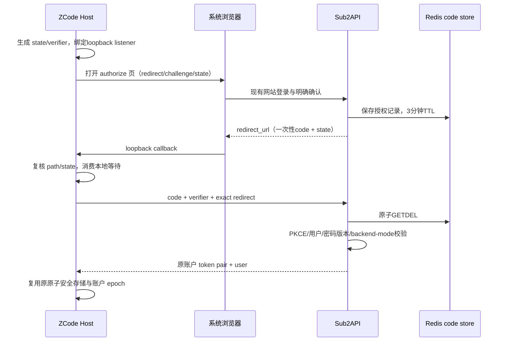

# 桌面客户端浏览器登录合同

2026-11-13。本合同补充 `DESKTOP_AGENT.md`，不改变旧 bootstrap v1/v2/v3 或普通模型 Key 的权限与计费。既有密码登录保持兼容，新 ZCode 默认使用系统浏览器授权。

## 身份与状态所有者

- 网站处理登录、验证码、两步验证及用户确认；页面为 `/desktop/authorize`。
- ZCode Host 生成随机 `state`、PKCE verifier，并只在 `127.0.0.1` 的随机非特权端口监听 `/callback`。端口先监听成功，再打开系统浏览器。网页不得接收 verifier 或桌面长期凭据。
- Sub2API 只通过 JWT 网页用户路由接受确认，不允许管理 MCP token 或模型 Key 代替网页会话。
- 一次性授权码由服务端生成 256 位随机值；Redis 只存以 SHA256(code) 为键的记录，TTL 3 分钟，包含用户、密码版本、redirect 和 challenge。原子消费是唯一交换准入点。
- 换证成功后复用既有账户 access/refresh token，token 绑定桌面换证请求的网络上下文。此阶段不新增设备授权表，也不宣称普通推理 Key 已具备每设备撤销。

## API

`POST /api/v1/desktop/auth/authorize`：JWT、既有面板用户限流和 backend-mode guard、审计。只接收 <= 4KiB `application/json`：

```json
{"redirect_uri":"http://127.0.0.1:49152/callback","code_challenge":"<S256 base64url, 43 chars>","code_challenge_method":"S256","state":"<random base64url, 22..128 chars>"}
```

响应沿用标准 `{code:0,data:{redirect_url:".../callback?code=...&state=..."}}`。前端只在明确确认后调用；取消不创建 code。

`POST /api/v1/desktop/auth/token`：公开端点，现有每 IP 限流 fail-close，JSON <=4KiB：

```json
{"code":"<43-char opaque code>","code_verifier":"<RFC7636 unreserved,43..128 chars>","redirect_uri":"http://127.0.0.1:49152/callback"}
```

响应与现有登录一致：`access_token,refresh_token,expires_in,token_type,user`。刷新及退出继续使用 `/api/v1/auth/refresh`、`/api/v1/auth/logout`。本端点不降级为只有 access token；Redis 或 refresh 持久化失败必须显式失败，让用户重启授权，不重放旧 code。

所有响应 `Cache-Control:no-store`，无凭据或 code 日志。JSON 重复键、null、未知字段、大小写别名、超限体积和错误 Content-Type 均拒绝。

## 校验与失败规则

- redirect 精确为 `http://127.0.0.1:<1024..65535>/callback`，无 userinfo、query、fragment、编码路径、尾斜线；不接受 localhost、IPv6、外网、任意深链或任意 path。确认与交换要求字符串完全一致。
- challenge 必须是规范 S256 base64url，拒绝 plain；verifier 只能 RFC7636 unreserved 字符，43..128 字符；constant-time 比较摘要。
- state 要求随机 base64url 形状，服务端按值返回；最终由 Host 与发起值 constant-time 对照。服务端不能证明客户端随机性。
- code 每次仅可消费一次，包括错误 verifier/redirect 的尝试；并发仅一方能成功，过期或重放一律 `DESKTOP_AUTH_INVALID_GRANT`。
- 交换时重新读取 active 且未删除用户，比较授权时密码版本，backend mode 不允许普通用户换证；失败不发 token。
- 这是显式网页授权到新的账户会话，不是转交浏览器 cookie；不改变现有普通会话撤销语义，不声称 code 消费后可以重试网络未知结果。



## 回归证据要求

验证正常流程、随机 state 保留、PKCE与redirect严格拒绝、重复/并发消费、TTL、Redis故障、用户停用/删除/密码变化、换证失败无令牌、错误JSON和body限制、backend mode及旧普通登录/刷新兼容。不需要真实模型消费或支付测试。

## 授权页品牌与显示合同

网页授权页和客户端本机回调页统一使用 **MiloCode** 可见品牌，协议 `client_id=zcode-desktop` 保持不变。网页沿用现有 card、btn、primary 与深色主题样式，窄屏保留完整账户、已验证的本机返回地址及明确确认/取消动作。页面不得显示授权 code、state、challenge、verifier、token 或服务端原始错误。

本机回调页面不拥有最终登录状态：合法回调只表示“授权已接收”，提示返回 MiloCode，由客户端完成换证并显示最终结果；取消和校验失败使用固定安全文案。页面不加载外部资源、不执行脚本、不自动关闭浏览器。沿用 no-store/no-referrer，并只用每次响应随机 nonce 放行自包含样式。响应完成/中止后一次性换证的原有时序不变。

本轮定向验收覆盖品牌、等待显式确认、拒绝和安全错误；本地浏览器覆盖中英文、浅深主题及390px，无横向溢出、外部资源和敏感数据反射。使用合成本机回调，不以此代替真实账户登录。

2026-11-13验收：现有授权组件/路由用例8/8、i18n完整性3/3、目标ESLint通过；配套客户端真实HTTP/loopback用例7/7。Playwright本地合成页面22/22（网页8个语言/主题/尺寸组合、2个错误状态，本机回调3态×2主题×2尺寸），已人工检查代表截图。脚本、截图及结果在 `output/playwright/desktop-auth-brand/`。没有执行生产账户换证、付费请求或生产写入。
