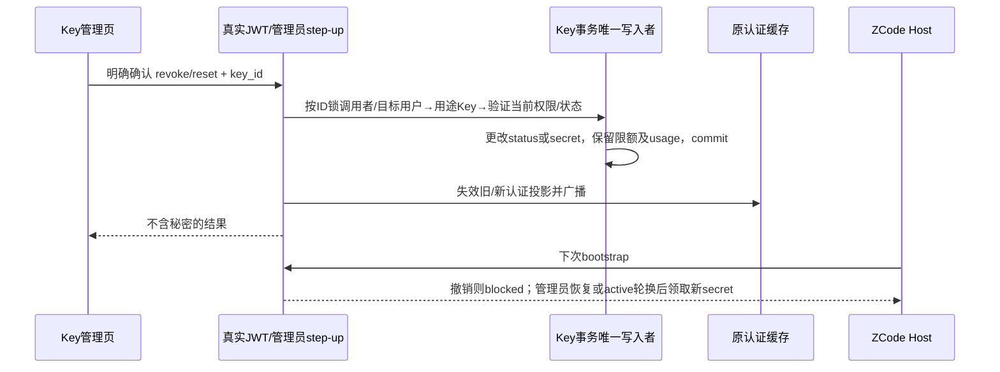

# 桌面客户端集成整理

2026-11-13。本合同在既有 protocol 1/2/3 之上增量演进，不改变网关计费、钱包或本地执行器。当前交付范围：配置页职责整理、公开模型能力档案复用、托管凭据撤销/重置、浏览器 PKCE 登录；每设备推理授权和任务费用归集为后续阶段，不在本次声称完成。

## 所有者与兼容边界

- `desktop_agent_config_v1` 仍是桌面配置唯一持久源。模型按聚合后的公开 ID 定义语义，不从供应商私有 ID 或前缀猜能力。protocol 1/2/3 响应不删字段、不改变兼容语义。
- 能力以随代码发布的已核对官方档案为基线，source=`official_openai`，不再从旧保存声明生成模板。已知公开 ID 自动套用，未知别名显式关联；特殊上游差异须管理员明确启用高级覆盖。官方规格和当前执行器限制分开呈现，见 [模型档案合同](./DESKTOP_MODEL_PROFILES.md)。
- `default_max_output_tokens` 保持原字段用于兼容，界面准确称“Agent 单次输出上限”；`max_output_tokens` 是模型能力档案的物理上限。客户端上限尚不是网关额外预算规则；真实准入仍由现有用户、Key、分组/白名单及余额限流负责。
- 本次账户登录仍取得现有账户会话；推理仍使用用户可读的专用 Key。没有宣称 Key 只能在官方客户端使用。MCP 管理授权与模型调用隔离。

## 凭据操作

本人真实 JWT 路由：`POST /api/v1/desktop/credential/revoke`、`POST /api/v1/desktop/credential/reset`。

完整管理员路由（复用本站现有 step-up 门控及其全局开关）：`POST /api/v1/admin/desktop/users/:id/credential/revoke`、同路径 `reset`。

请求严格为 `{key_id:positive integer}`，归属由真实认证用户或管理员目标确定，不能让 body 决定本人身份。响应只含 `{status:'revoked'|'active',key_id:number}`，no-store，不包含 Key。

- revoke：保留同一用途行，将状态设 disabled；不删除行、不清用量、不修改分组，不影响其它 Key。没有匹配用途行/ID则拒绝，不能创建。后续 bootstrap 保持 credential_blocked，不能自动复活。
- 本人 reset：仅允许轮换 `active` Key 的 secret。任何 `disabled` Key（包括本人主动撤销）均拒绝本人恢复，返回 HTTP 403 / `DESKTOP_CREDENTIAL_RESTORE_ADMIN_REQUIRED`；重复登录、重连、bootstrap 均不能绕过。管理员通过本人接口操作自己的 Key 也遵守这条规则。
- 管理员 reset：只有完整管理员通过管理路由和现有 step-up 门控后，才能显式恢复 `disabled` Key；受限管理员拒绝。`active` Key 也可显式轮换。`expired`、`quota_exhausted`、未知状态、实际已过期或已耗尽额度均拒绝，不能绕过限制。恢复不改变目标账户停用状态；目标账户已停用时拒绝恢复，仍可撤销其 Key。
- 两类 reset 都旋转同条 Key 的 secret，保留所有配额、已用量、过期时间、速率窗口。操作作用于该用户所有设备及复制的旧 Key，不宣传设备级撤销。管理页的指定用户 Key 列表提供恢复入口；接口不返回新秘密，恢复后由本人通过既有领取/读取链路取得。
- handler 只从真实认证上下文和管理员 step-up 门控结果构造可信调用者，action body 不能声明管理员/恢复权限。事务按用户 ID 顺序锁定调用者与目标用户，锁内重新校验调用者账户状态及当前管理员角色，再锁目标用途 Key 并判断当前状态；与领取/撤销共用用户→Key锁顺序，防止并发停用/撤权后凭旧快照恢复。仅事务提交后失效旧/新 secret 对应认证缓存与现有跨实例通知；请求取消不跳过提交后的缓存清理。
- Key 不存在时 reset 不以此创建；正常首次领取仍只由 bootstrap 完成。重试 reset 不是幂等操作，前端不在未知提交结果后盲目自动重试。

退出本机只清本机账户/模型材料；停止配置下发只改变已保存enabled；撤销Key才停止后续使用该Key的新网关请求。已在执行的上游流不承诺被远程强杀。

## 浏览器登录

入口 `/desktop/authorize`。ZCode Host 拥有 verifier、state、loopback listener、超时与取消；Renderer 只打开安全URL并显示进度。网站认证页处理验证码、二步验证及第三方登录，授权页需用户明确确认后发码。

固定 `client_id=zcode-desktop`、`response_type=code`、S256；回调仅允许严格 `http://127.0.0.1:<port>/callback`，无用户名密码/query/fragment/任意路径。授权码3分钟过期、一次消费；state为随机关联值。API详见 [DESKTOP_BROWSER_AUTH.md](./DESKTOP_BROWSER_AUTH.md)。

服务端存储授权时user/tokenVersion、redirect和challenge，交换时重验，发既有token pair；不发管理MCP token。客户端在当前登录epoch且未取消时原子保存token pair，迟到回调/换号结果丢弃。取消/完成/过期必须关闭监听并释放秘密。网站不直接将登录cookie或access token放进回调URL。

## 验收场景

1. 旧桌面线协议与其它系统Key保留；旧官方模型能力重新校准，未知旧别名隔离直到显式关联档案；关联保留公开ID、来源可见、未知能力不自动猜。
2. revoke后bootstrap仍blocked；重复bootstrap不创建新Key；本人reset不能恢复disabled；只有管理员管理入口经过现有step-up门控后可恢复，旧secret不可用，新secret可领。
3. 错用户、错Key用途、错ID、空/重复/多余/超长字段拒绝；body注入管理员/step-up权限拒绝；管理员step-up与restricted admin规则生效；事务内再次拒绝已降权/停用调用者。
4. reset不重置额度/用量/过期/限流；过期或耗尽拒绝；数据库失败不提前清缓存；提交后清旧新cache。
5. 浏览器登录开启验证码仍可用；state、PKCE、redirect、code过期/重复消费、停用账户/tokenVersion变更、取消/超时及跨窗口迟到结果覆盖。
6. 配置表中默认和硬上限准确，高级区可维护自定义能力；窄屏/明暗/i18n及现step-up草稿隔离。
7. 现主/子/标题计费身份、普通API和生图相关定向回归保留，不发真实付费请求验证代码。
