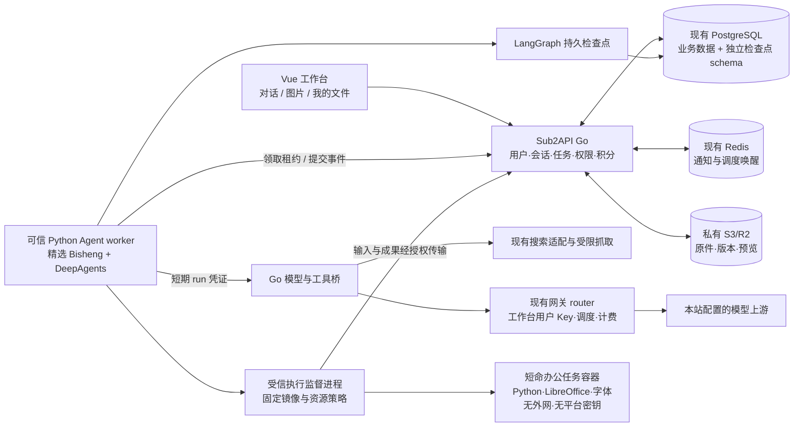

# 工作台对话与办公 Agent 设计

状态：方案评审稿，尚未实施业务功能、数据库迁移或生产变更。

日期：2026-11-18。

设计分支：`codex/workbench-office-agent`。

本仓库基线：`7ad6965c3`，已快进合入并推送 `main`，包含此前已上线的官方 v0.2.23 同步。

Bisheng 审计基线：`a8e5be89c1b8d3a2e512c772e2a38de409336dc8`，2026-11-17，`Hotfix/3.0.2 (#2719)`。

## 1. 建议决策

把工作台升级为“对话为主、文件为成果”的办公入口。一级工作区仍叫“工作台”，个人侧提供三个入口：**对话助手、图片生成、我的文件**。进入工作台默认打开对话助手，已有图片生成链接继续有效。

推荐采用 **Vue 原生页面 + Sub2API Go 业务主干 + 同仓的 Python Agent worker + 按任务隔离的办公执行环境**。

- 从 Bisheng 选择性移植真实的 Agent 编排、办公技能、文件验证脚本和任务交互，而非只模仿外观。
- React 页面按现有 Vue 组件体系移植；不整站重写、不嵌入整套 React 应用、不做 iframe 外挂。
- 用户、会话、文件归属、模型分组、积分、任务管理统一归 Sub2API；不再运行第二套 Bisheng 账号和余额系统。
- 保留 Agent 内部使用 Python 处理办公文件的能力；用户没有开发终端、装包和操作宿主机的入口。
- 只有实际处理文件时才占用办公执行槽。任务完成、取消或等待用户时释放计算资源，无需每用户一台常驻虚拟机。
- 原有图片生成、异步图片 API、云端图库和公开模型 API 保持独立运行。新模块故障应只影响新模块。

这是深度集成方案，但不是“所有代码都必须用 Go 写”。将 Bisheng 的 Python 内核硬翻成 Go，反而会失去实质复用，也会增加后续维护工作。

## 2. 从 Bisheng 真正搬什么

### 2.1 已核实的事实

当前 Bisheng 前端为 React/TypeScript。它的 `@bisheng/chat/core` 有与 React 无关的会话整理逻辑，但包说明明确排除了日常聊天和任务/Linsight 界面。用户看中的任务执行过程、成果面板等在独立 TSX 组件中，不能把一个 npm 包装进 Vue 就完成集成。[B1][B2]

当前 Linsight 的装配点已使用 `deepagents.create_deep_agent`。其外围又绑定了 Bisheng 的配置、模型服务、租户、会话 DAO、工具服务、MinIO、Redis 和引用逻辑。因此不存在已核实、可直接挂载的“精简 Bisheng Agent 后端”。需要抽离内核，替换业务适配层。[B3][B4]

Word、Excel、PPT 技能包含实际提示、模板和检查/渲染脚本。其自由办公能力依赖代码解释器执行生成的 Python，并调用预装转换器。删除代码执行、只留下几个模板接口，不能视为保留了相同的办公能力。[B5][B6]

官方共享 sandbox runner 采用会话 UID 和工作目录隔离，支持 Python 与 shell；同一容器共享资源。更值得注意的是，Dockerfile 的“无出网”注释与该版本 Compose 不一致，Compose 实际允许公网访问。不能原样搬进本站后就宣称已经具备安全的多租户隔离。[B7][B8]

### 2.2 移植清单

| 部分 | 处理方式 | 需要适配的地方 |
| --- | --- | --- |
| 对话输入、消息、引用、任务进度、澄清、成果面板 | 移植布局与行为，改写为 Vue | 本站组件、主题、路由、资源授权、移动端 |
| 与 React 无关的 TS 数据整理/步骤树工具 | 经测试后选择复用 | 本站事件格式；不强套不适用的 workflow 消息协议 |
| DeepAgents/LangGraph 编排 | 保留成熟内核，在内部 Python worker 运行 | 模型桥、检查点、工具与事件适配 |
| Bisheng 技能、精选中间件、上下文管理和引用逻辑 | 按文件锁定来源后抽离 | 清除知识库、租户、配置服务依赖；逐项测试 |
| DOCX/XLSX/PPTX 提示、模板、检查/渲染辅助程序 | 优先复用 | 固定环境路径、依赖版本、输出发布与限额 |
| Bisheng 模型配置、API Key、用户、权限、MinIO 会话 DAO | 不引入 | 由本站已有业务与新增统一资源接口承担 |
| 工作流画布、RAG、向量数据库、应用市场、OpenFGA | 不引入 | 不属于本期需求 |
| 官方通用 shell/旧执行器和整套后端依赖镜像 | 不直接复用 | 办公执行必须经过本站唯一受限执行入口 |
| OnlyOffice 等完整在线编辑套件 | 首期不引入 | 首期是预览、下载、通过对话修改并产生版本 |

建议在同仓新增 `services/office-agent/`，将选取的原文件和本站适配层分目录维护；记录来源 commit、原路径、许可证、修改内容与兼容测试。依赖锁定，不跟随 Bisheng main 自动升级。

根许可证与已检查的嵌套技能为 Apache 2.0。正式移植时保留许可证、版权/归属和适用 NOTICE，并标记修改；模板、字体和第三方资源逐项核对。排除不需要的预构建商业组件。这里不要求保留 Bisheng 产品名称或 logo。[B11]

## 3. 用户看到的工作台

### 3.1 名称与布局

菜单推荐叫 **对话助手**。“文本对话”容易让人以为只聊天，“对话办公”又不太像自然的产品名称。页面首次使用时用“问问题、查资料、处理文件”说明用途。

桌面布局沿用现有工作区切换与主题：

1. 左侧仍是一条工作台侧栏：上方放对话助手、图片生成、我的文件；对话页在下方显示当前会话列表，可折叠。不再并排叠第二条永久会话侧栏。
2. 中间是对话。顶部只放会话标题、模型选择与必要操作，输入区放附件、联网搜索开关和发送/停止。
3. 右侧是按需出现的文件预览/成果面板。有文档时自动呈现，普通聊天时收起。版本、下载、继续修改围绕当前文件组织。
4. 多步骤任务在消息中显示可折叠的“正在查资料／处理表格／检查文档”等过程和待办；无需展示开发终端或原始内部推理。
5. 等待补充信息时在当前消息中呈现问题；不是报错，也不一直占着算力槽。
6. 窄屏切为“对话 / 文件”页签，预览全屏打开，模型和附件控件不挤占输入框。

这部分以 Bisheng 的任务与成果交互为主要移植对象，同时适配本站组件库。可用已有组件的地方复用组件，不另造一套弹窗、下拉框、上传器和通知系统。

### 3.2 一套对话，按需要用工具

不强迫用户先理解“普通模式、研究模式、Agent 模式”的技术差异。普通问答直接回答；开启联网时可以搜索；附上文件或要求生成文档时启用对应办公工具。

后台可以使用不同的执行预设，但共享会话、运行记录、事件与资源接口。普通聊天关闭不必要的规划/子 Agent，中间不额外跑一遍复杂规划；办公任务按需启用 Bisheng/DeepAgents 能力。只有真实需要文件工具时才分配办公容器。

默认不为每轮生成标题、规划或摘要各调一次模型。标题先从用户首条消息生成；长会话在接近上下文预算时做有记录的摘要。联网、文件处理、自动修复产生的额外模型费用，用户能在本次用量中看见。

首期支持：普通问答、带来源的搜索、文档总结、生成与修改 DOCX/XLSX/PPTX、PDF 阅读与预览、继续修改既有成果。首期不含浏览器操作、邮件发送、电脑控制、任意 MCP、用户自装插件、RAG、团队协作编辑和跨会话自动记忆。

### 3.3 一个完整使用例子

用户上传一份销售 Excel，说“按月份分析销售额，给我做一份 Word 报告和六页汇报 PPT”。本站保存上传原件和消息，创建任务；Agent 读取表格结构、运行统计并画图，用迁入的办公技能生成报告与 PPT，再重开/渲染检查。右侧出现两个成果卡片，可预览、下载。

用户接着说“第三页改成季度对比”，任务从上一版 PPT 和明确引用的表格重建临时目录，生成新版本；原始上传、报告和旧 PPT 均保留。用户换电脑可继续看同一会话与成果。离开页面不等于停止任务；真正停止要点“停止”，费用展示已实际发生的模型调用。

这里没有给用户创建永久电脑，也没有把所有中间文件永久塞进桶；长期保留的是会话、明确资源版本与必要任务记录。

## 4. 系统边界与部署



### 4.1 一套业务、一个新增部署单元

现有 Go 服务继续拥有对外 API 与业务真相。新增 office-agent worker 是内部能力组件，不单独经营用户、余额、分组或文件权限，也不向浏览器暴露 Bisheng 的 API。

Go 负责接单、持久运行状态、租约、幂等、取消、权限、费用归集；Python 负责 Agent 图内的推理与工具编排。**不再复制 Bisheng 的第二套外部任务调度和状态系统。** LangGraph 内部的步骤编排不等于另一个平台级调度器。

部署上只新增一个 worker 部署单元：其中运行可信 Agent 编排和受信任务监督组件，按需创建临时执行容器。监督组件是一个窄接口，只允许固定镜像、固定挂载规则和批准的限额；不向模型提供通用 Docker API。容器运行时 socket 不进入 Python 脚本容器，也不作为可调用工具暴露给 Agent。

若用户可以提供额外机器，推荐把这个部署单元放在独立 Linux 算力机，经过私网或受认证的加密通道连接主站。这样文档内存峰值、转换器崩溃和磁盘增长不直接挤占模型网关。无需先引入 Kubernetes、Kafka、独立向量库或另一套用户服务。

这个边界有成熟实现可参照：LibreChat 将代码执行作为认证的独立服务；Open WebUI 明确区分进程内 Python 插件和外部工具服务；Dify 也把执行沙箱单独隔离。我们借鉴其业务与执行分离模式，不再引进这些项目组成另一套平台。Bisheng 当前所用的 DeepAgents SDK 也支持自托管及自定义 backend/checkpointer。[E6][E7][E8][E9]

### 4.2 可信编排与不可信执行分开

可信 Python 编排器只运行经过审阅的本站代码和固定技能适配；它可以访问模型桥、检查点与明确的内部服务。**模型生成的 Python 不能在这个进程内 eval/exec。**

脚本只能进入任务执行容器：固定依赖、无外网、无数据库/R2/模型凭据、非特权、只读基础镜像、只允许本任务目录、CPU/内存/PID/时间/磁盘/输出限额。优先用 gVisor `runsc` 做增强隔离；必须先验证目标 Linux 环境和 LibreOffice/字体/渲染兼容性。[E1]

禁止用户终端、包安装和通用 shell 工具，不等于 Python 就无法调用系统能力。安全边界来自 OS 运行时、网络、挂载和限额，不能依赖 Python import 黑名单、AST 检查或提示词。

需要彻底替换并禁用 Bisheng local/container/e2b 等旧执行器 fallback，以及 DeepAgents 自动注入的通用执行、动态 MCP 和任意 URL 工具入口。保留的文件工具也只能访问任务虚拟工作区，不能落到宿主机任意路径。

如果增强隔离兼容性尚未验收，先不公开自由脚本办公；不能静默降级为在网关进程或宽权限共享容器内执行。

## 5. 模型、工作台 Key 和计费

### 5.1 继续使用现有工作台分组

代码核实：现有工作台是**每用户一把系统托管 Key**，分组跟随工作台设置，并非全站用户共用一把管理员 Key。新对话与图片功能继续使用同一用户的这把 Key，管理员只需在工作台分组加入文本模型。

不复用 MiloCode 的桌面 Agent Key，不依赖桌面端启用开关，不新建第二套积分。当前固定名“生图工作台专用”同时参与幂等查找，实施时应升级用途标识或做兼容迁移，再将显示名改成“工作台专用”；不能直接改常量导致每用户多建一把 Key。

### 5.2 模型目录与参数

复用分组公开模型目录和远端官方能力档案的基础能力，提取公共服务；不直接复用桌面端 bootstrap 和桌面专用过滤结果。

- 页面按照**对外公开模型 ID**定义参数语义，不追溯聚合前的上游名字重新解释用户选的模型。
- 对话列表只展示实际目录中的文本模型，不能因为同组有图片模型就全部放进去，也不补预定义模型名。
- 自定义别名没有已知能力档案时，允许基本对话；工具/视觉等能力需要明确的档案绑定或声明，不能凭空声称支持。
- 工具调用、视觉、推理强度、输出限制分别判断。基本对话可用的模型，不一定适合办公 Agent。
- 使用厂商官方支持的参数与上限，不复制 Bisheng 自己的模型表、过期上下文值或统一 `temperature`。
- 平台任务预算与模型官方最大值是两回事；可限制一次任务的消费，但不把官方上下文档案改成编造的数值。
- 文档通常先在执行器提取结构/文字，不要求把整个二进制附件直接发给模型。发送图片/页面预览时再检查视觉能力与大小预算。

模型协议使用原网关及现有 RelayKit 转换链。Python 适配器调用网关已支持的端点，不再写一套 Claude/Gemini/OpenAI 转换器。具体文本端点覆盖和工具语义在技术验证阶段跑通，不能只测试一款 GPT 就承诺所有模型可做 Agent。

### 5.3 Key 不交给脚本，模型调用仍完整过网关

Go 为每个 run/租约签发内部短期模型桥凭证，绑定 user、run、lease epoch、允许的模型/操作与有效期。Python 获得该凭证，不获得用户长期 Key；执行容器连此凭证也没有。

桥接入口在每次调用时重新检查任务是否有效、租约、组权限、可用余额和任务预算，然后由 Go 读取对应工作台 Key，构建普通请求经过原 gateway router。内部入口不接受模型指定的任意 Base URL、任意用户 ID 或任意代理路径，也不绕过原鉴权、调度与账本。

run 保存接单时的分组/权限/能力版本。管理员运行中更改工作台分组或撤销 Key 时，暂停新步骤并重新校验，不静默将同一任务切入另一套价格和权限。worker 失联或取消也不免除已发生/晚到的真实 usage。

每次实际模型调用关联 `conversation_id / run_id / step_id / operation_id / request_id`；使用服务端可信元数据，不相信客户端伪造的关联头。用户管理页可展开查看子调用、上游路由、耗时、Token 和费用。

本仓库 `ClientRequestID` 中间件信任 Go context，不读取来访的同名 Header。模型桥须在校验并登记 invocation 后设置 `ctxkey.ClientRequestID` 再进入 router，不能只让 Python 带一个 Header 就认为关联和幂等已生效。

**费用只由现有 usage/积分账本记录。** run 页聚合这些调用的费用快照，不在任务完成时再扣一次总费用。规划、检索归纳、摘要、自动修复和子 Agent 调用也都计入本次总用量。

任务预算用于约束继续发起调用：发起前按剩余预算和最大输出限制做准入/必要的额度预留，结束后以账本实际用量结算。多调用并发须共享预算，不能每个子 Agent 各用一份。若存在在途调用或最终 usage 尚未回收，要展示待结算；不能承诺任何上游下都恰好停在某个金额。

网关负责上游可重试/故障切换；SDK、Bisheng resilience、LangGraph 不得再各重试三次，造成乘法放大。新一次语义修复调用与同一次传输重试要分别记录。对于已提交付费请求但结果未知的情况，不因浏览器断线、租约过期或 SDK 超时就自动重放。

**账本去重不等于模型执行去重。** 桥层为每次 invocation 保存 `prepared / dispatched / completed / unknown`、请求哈希和可回读的结果：相同 operation 与输入重复提交时返回原结果/运行状态，不能重新发给供应商；相同 ID 不同输入拒绝。已 dispatched 却缺少确认时先对账或进入 unknown。否则可能出现供应商实际扣两次、本站因账本 ID 去重只记一次的错误。LangGraph 恢复须经过这个 inbox，不能直接重跑外部调用。[E10]

## 6. 会话与任务持久化

### 6.1 建议的逻辑实体

以下是新增模块的概念模型，不是本轮已实施的表结构：

| 实体 | 关键内容 |
| --- | --- |
| conversations | 所属用户、标题、归档状态、当前模型、时间 |
| messages | 消息角色、分段内容、附件/引用、可见错误、所属 run |
| runs | 幂等请求、模型与限额快照、状态、租约/epoch、取消、费用汇总引用 |
| steps / operations | 工具和模型步骤、稳定 operation ID、参数摘要、结果引用、实际请求关联 |
| run_events | 按 run 递增序号、可去重事件、适度合并的流式片段 |
| resources / versions / derivatives | 用户文件、不可变版本、缩略图/PDF/页图等衍生物 |
| resource_refs | 会话、消息、任务与文件版本的引用 |
| LangGraph checkpoint schema | 编排状态、待办、工具结果引用、暂停恢复位置；不存二进制文件与密钥 |

不把这些字段塞进图片任务 spec，也不把 DOCX 硬塞进图片图库表。

### 6.2 恢复与状态

状态建议：`queued → running → waiting_user / completed / partially_completed / failed / cancelled`。基础设施故障可进入 `recovering`；仅在外部调用已经发出但结果无法确认时使用 `needs_confirmation`，并向用户说明是哪一步、是否可能已计费，不能笼统显示“结果待确认”。

Go 是公开任务状态的唯一来源。LangGraph 检查点保存执行内部状态，使用同一 PostgreSQL 的独立 schema 与最小权限角色，不另建一套数据库产品。优先采用官方持久 PG saver，而非进程内 MemorySaver；依赖版本与迁移由 worker 发布控制。[E2]

用户消息/run/调度 outbox 在同一 Go 事务中接纳，提交后再唤醒 worker。thread/checkpoint ID 由服务端映射，浏览器不能自选他人 thread 或历史检查点触发 replay。Python 的数据库角色仅能读写检查点 schema，不能直接操作用户、usage、积分和业务资源表。

Go 的 run 状态和 LangGraph 检查点不是同一事务，因此必须显式处理：

- 单会话同一时刻只允许一个活动 run；同一 thread 保证单写。
- Go 唯一发放租约和递增 epoch。模型桥、事件、成果发布及检查点写入都验证当前租约；PG saver 不能仅用无条件写入，需结合单写锁/失效检测与 fencing 适配。
- 事件带稳定事件 ID，Go 接受后才分配公开序号。先持久、后推送；失败重传可去重，不能重复产生 usage。
- 工具操作保存发起/完成记录，检查点保存与 operation journal 做恢复对账。外部付费调用不承诺 exactly-once；出现不确定结果就停在明确状态，不盲目重跑。
- 收到取消先停止下一步模型/工具调用，撤销 run 凭证并结束容器；已发生费用如实保留。
- 等待用户时先归档恢复所必需的输入/中间成果及 manifest，控制快照大小，完成后才进入 waiting_user 并释放执行槽；超出限额需明确处理，不能假定工作区总是很小。恢复时重建目录，只接受当前 interrupt 的幂等回复，多标签页重复回答不得启动两次。终态成功只在成果归档、引用登记完成后发布。

PG saver 本身不理解本站租约，fencing 适配是本项目需要实现并故障验证的工作，不是安装依赖即自动获得。恢复对账以 Go 的 invocation/成果记录补齐晚到的检查点；检查点已有结果而公开状态未更新时补状态，不再执行一次模型或发布一次文件。检查点与事件都需有保留/压缩与容量策略，不能无限保存每轮完整上下文副本。

保留中的会话和可恢复检查点也要引用明确文件版本；检查点 prune 后才能释放仅为恢复保留的快照。取消后的晚到事件可以供对账，但不能把 cancelled 改回 completed；真实已发生的 usage 仍应结算。

浏览器使用本站 SSE，携带最后已见的事件序号恢复订阅；超出事件保留窗口时加载消息/任务快照。**刷新页面只重连和补读，不重交任务。** 不为每个 token 写一条数据库记录；流式片段按字节/时间小批合并，队列与累计事件体积均设上限。

公开事件采用允许字段清单，只输出消息、工具进度、简要结果、公开引用、成果 ID 和可理解的错误。Bisheng/LangChain 的全量 callback 不直接存进公开 SSE；内部推理、凭证/签名 URL、服务器路径与堆栈不能未经处理进入用户消息。协议所需的供应商 reasoning/tool 信息与对用户展示的事件分别管理。

长会话按模型能力控制上下文，保留原消息与摘要边界，附件读取分页。首期不默认跨会话扫描全部“我的文件”，也不新增向量数据库。

## 7. 文件、图库与对象存储

### 7.1 统一资源入口，渐进整合旧图库

推荐新增“我的文件”，统一呈现上传文件、生成文档和现有图库图片。图片仍可在原图片生成页查看历史和编辑。

首期为旧图库增加资源适配器：旧图片的归属、文件路径和删除语义仍由图库服务处理；统一文件选择器能选用它们，不复制对象，不移动 `studio/v1/`，不强改图片表。新办公文件使用通用资源元数据。待新功能稳定后，再决定是否将底层元数据进一步统一。

这里必须补齐**跨模块引用保留**：当前图库 cleaner 只认识生图任务/输入引用，不认识新对话引用。对话选用旧图片时需登记图库也可识别的 retain/pin，删除条件与清理查询一起适配，文件/对话删除时再 release。否则用户删除原生图任务，可能连带删掉对话正在使用的图片。不能只在新表记同一个对象 key 就认为兼容完成；阶段 2 的上线条件包括这条引用链验证。

物理存储不需要每用户新建桶。优先复用现有私有图库的 S3/R2 连接配置，办公文件用独立前缀（建议 `workspace/v1/`），由数据库 owner/权限验证实现逻辑隔离。路径里带用户 ID 只是组织方式，不是访问控制。

如果现有桶有全桶生命周期删除，或不同用途保留期冲突，就复用连接凭据但单独选一个私有办公桶；这不是再设计一套存储后端。不能为了复用桶而让长期文档被原生异步图片的 1 天/7 天规则删除。实施前必须核对线上生命周期规则及适用前缀。

存储配置也要注册新用途：当前目标变更/禁止公网域名保护只检查图库、图片任务和工单附件；需将办公 resources、staging、在途上传纳入 target-in-use/private guard。通用资源配置应从底层 storage profile 提取，不能直接调用受“云端图库开启”约束的接口。对话/办公/资源开关与原图片工作台/云端图库开关分开，保留旧开关的含义；关闭图库不应让已保存的办公文件失联。

不复用 MiloCode 公共下载桶，不把办公文件设为公开访问。预签名地址只在通过本站授权后签发，并沿用已有缓存、有效期与 CORS 设计；预签名 URL 可在有效期内重复访问，并非一次性票据。

### 7.2 临时盘与对象存储分工

对象存储保存原件、可交付版本和预览；它不充当 Agent 的 POSIX 工作盘，也不为每一次脚本中间读写发起 R2 请求。

每个任务的工作区建议为：

```text
<opaque-run-id>/
  input/        # 当前任务有权使用的输入，只读
  work/         # 处理中间文件，限额，可丢弃
  out/          # 候选成果，未发布前不算交付
  preview/      # PDF、页面图等衍生预览
  lo-profile/   # 本任务专用 LibreOffice 配置
```

可信监督组件负责授权 copy-in/copy-out。执行器拿不到整个用户资源库、整个桶、其他任务目录或长期凭据。输出登记前检查实际类型、路径/符号链接、体积、文件数量与内容安全策略，不能信任脚本回报的文件名和 MIME。

持久消息、工具结果和检查点保存资源/版本 ID 及逻辑路径，不保存 R2 预签名 URL、模型桥凭证等临时访问能力。传输层按需组装模型可读取的授权素材。可信监督组件可获限定对象/操作的短期传输地址，用于从对象存储下载输入和上传候选成果；无网脚本容器只看本地文件，不接触这些地址。用户预览/下载仍可直达 R2，不让主站持续承担原文件下载带宽。

后续修改选择明确资源版本并下载重建工作区，不复制整段会话的全部上传文件。等待用户/故障恢复时只归档必要快照，使用独立短期 staging 前缀与 TTL；不照抄 Bisheng 每轮复制 uploads/scratch 的对象增长策略。[B9]

Bisheng 技能原有 `uploads/output/scratch` 路径约定，与上面的磁盘布局不同。移植时通过虚拟工作区映射并适配脚本保持一致，不能靠模型每次自行猜路径。检查点引用稳定资源/逻辑路径，不写某台 worker 的绝对临时路径。

临时盘有任务硬限额、全局预留和低水位拒绝接单；超时/崩溃后也由清理器回收。成功、失败、取消均要验证容器与目录最终可回收。生产机不积累每次任务的镜像和永久临时目录。

### 7.3 版本、删除与配额

- 上传原件保留，编辑输出新版本，不覆盖用户原件。文件卡片显示版本和最近生成时间。
- 对话引用具体版本；历史消息里的下载内容不能随着“最新版本”悄悄变化。
- 删除对话默认只删除对话及引用，保留“我的文件”中的资源；删除文件是单独操作并说明引用影响。
- 活动任务正在读取的资源先固定版本/引用，删除请求可延迟物理清理；不能让一半输入突然消失。
- 原件、版本和衍生物按实际字节计配额，旧图库适配不重复计数。未完成上传用预留额度，失败释放。
- 删除走可重试的后台清理，区分逻辑删除和对象删除成功；有权限检查和审计，跨用户不做可观察的共享去重。

### 7.4 预览策略

列表只加载缩略图与元数据；进入文件面板再取阅读预览，点击下载才拿原文件。DOCX/PPTX 以服务端渲染 PDF/页图为主要阅读预览；XLSX 可用分页表格和必要图表/打印预览，不能把十万行一次塞进浏览器。现有图片继续使用 thumb/preview/original 分级。

预览按不可变版本和渲染器版本缓存；重连、切换列表不会重新转换。前端库采用安全配置，不执行上传文件里的 HTML/宏/脚本；首期不直接内嵌模型生成的任意 HTML。同源 cookie、对象存储 CORS 和下载文件类型要分别控制，不能把“有签名”当作内容可执行的许可。

## 8. 办公能力与结果验证

预装依赖以实际迁入技能为准，优先 `python-docx`、`openpyxl`、`python-pptx`、必要的数据/绘图库、LibreOffice、PDF 工具和有许可的中文字体；需要 pandoc 等再显式加入。不要安装 Bisheng 整份后端 lockfile，也不允许任务临时 pip/npm/apt 安装。

能力闭环是：**读输入 → 生成/修改 → 重开检查 → 必要时重算 → 渲染预览 → 检查 → 有限修复 → 归档交付**。

| 文件 | 至少验证什么 | 不能夸大的边界 |
| --- | --- | --- |
| DOCX | 可重开、章节/表格内容、字体与分页渲染、明显溢出 | 复杂原件编辑不保证所有版式/嵌入对象无损往返 |
| XLSX | 工作表/类型、公式、错误单元格、必要重算、关键统计与图表 | openpyxl 本身不计算公式；LibreOffice 与 Excel 存在函数/布局兼容差异 |
| PPTX | 可重开、页数、文本/图形边界、逐页渲染、字体与裁切 | 不是完整 PowerPoint 引擎，不承诺任意特殊模板完全保真 |
| PDF | 页数、可提取内容、页图渲染、必要文字/图像检查 | 扫描件 OCR 另行评估，不默认引入本地大模型 |

“重新读取一次文件”不等于完成版式验证。应让 Agent 看到结构检查结果与必要页面预览；选中模型没有视觉能力时，确定性检查仍可做，但不能标为已通过模型视觉审阅。若未来增加独立视觉审阅模型，须来自同一工作台组并明确展示额外用量，不偷偷调用另一家模型。[E3][E4]

对外只展示真实完成的验证。工具失败、修复达到预算或某些页无法渲染，要具体说明；已成功的成果可标为部分交付，不伪装成全成功。

## 9. 联网搜索与输入治理

复用本站已有 Brave/Tavily 配置、供应商管理与搜索适配器，把它们作为受控 `web_search` 工具接入。现有网关搜索模拟只覆盖特定单搜索工具场景，不能直接当作“搜索+办公”的完整 Agent 循环。

抓取网页由可信联网工具完成，限制协议、域名/解析后的 IP、重定向、内容类型、响应大小和超时；拒绝本机、内网、云元数据等地址，并在每次重定向重新校验。结果保留来源 URL 与引用信息。首期不做完整浏览器自动化，也不因此引入 RAG。

搜索结果、网页和上传文件均是不可信资料，不能授权增加工具、读取其他文件或发起任意外部动作。执行器保持无网；需要的资料由工具提取并按任务写入输入。搜索也设置每用户/run 的次数和并发，不只依赖供应商月额度。

上传限制实际格式、大小、文件数和解析成本；Office 压缩包限制解压后总量、条目数和路径。首期以现代非宏格式为主，禁用宏、外链刷新和嵌入执行。旧二进制/加密文件给出明确不支持或转换提示，不在可信进程里勉强解析。

## 10. 管理端与最小配置

继续放在既有“工作台”管理员上下文，个人侧不出现运维参数。

| 页面 | 内容 |
| --- | --- |
| 工作台概览 | 对话/图片分别统计；活跃任务、用量、文件容量、执行队列与失败趋势 |
| 任务记录 | 图片/对话类型筛选；按用户姓名/邮箱/昵称搜索；展开模型子调用、上游、工具、错误与费用 |
| 用户资源 | 统一入口，按用户/类型筛选；沿用已有管理员图库权限，文档内容访问另行显式授权并审计 |
| 工作台设置 | 现有分组 + 对话/办公开关；搜索配置引用；私有存储引用；每用户并发/任务预算/容量 |

运行时地址、认证、镜像与 CPU/内存/磁盘硬限额属于部署配置，不让普通管理员随意填写 shell、脚本路径或任意工具 URL。后台显示“健康、可用槽、队列、磁盘水位”等状态即可。

限流复用现有面板 RPM 做入口保护，但额外需要任务级并发、最大步骤、工具次数、时长与消费边界。一条合法 HTTP 请求也可能触发几十次模型/工具调用，RPM 不能替代这些限制。

不把“用户在会话中分享给助手的文件”默认开放给所有管理员随意全文浏览。普通运维可看元数据和故障摘要；必要的内容访问要有明确权限、动作与审计。已有图库查看不因本设计立即变更，文档访问在新增功能中明确定义。

## 11. 资源预算与算力建议

模型继续使用站上远端上游，办公服务器主要运行文件解析、Python 和转换渲染，首期不需要因 Agent 本身购置 GPU。

可以用独立 **4 vCPU / 8 GiB RAM、数十 GiB 可用临时盘**作为小规模技术验证起点，先开 1 个办公执行槽，再按实测考虑第 2 个。这是压测起点，不是固定承载人数或采购结论。复杂 PPT、大图片和大表格可能需要更高单任务内存。

配置分三层：

- 用户层：活动任务数、排队数、文件容量、上传大小。
- run 层：总步骤/工具数、总时长、模型用量预算、修复次数；包括子 Agent 的共享总预算。
- 执行层：CPU、内存、PID、工具超时、临时盘、输出文件数/字节、节点磁盘水位。

首期办公脚本串行执行，子 Agent 默认关闭或只批准一个受限 researcher，禁止递归派生。随后是否并行必须由真实压测决定。即使只有一个 run，DeepAgents 也可能发出多个并行 tool_calls；模型桥和执行监督组件必须硬限制它们，不能把“每用户一个 run”误认为“最多一次模型调用/一个进程”。

先以 10/30 页中文 DOCX、10/30 页带图片 PPTX、1 万/10 万行 XLSX 及公式/图表组合做样本。记录 p50/p95 耗时、峰值 RSS、临时盘、归档/预览体积和队列时间，再定默认硬限制。不能照抄 Bisheng 的“2 GiB / 50 会话”配置当作本站容量。

最重要的容量原则：普通问答不占 Office 槽；等待用户不占槽；重型转换有界排队；worker 故障不拖垮 API 网关；磁盘不足时拒绝新办公任务而不是撑爆整机。[E5]

## 12. 分阶段落地和验收

### 阶段 0：证明移植与隔离方案能成立

先做最小纵向技术验证，不大铺页面：

1. 从锁定版本抽出 DeepAgents 装配与一个真实 Bisheng 办公 skill，清除配置/租户/RAG 耦合；列出保留和改写的代码归属。
2. 通过原工作台用户 Key 与模型桥，使用实际文本模型完成工具调用与流式输出，核对原 usage/积分/路由日志。
3. 在目标 Linux/gVisor 环境生成一个有中文、表格的 DOCX，渲染检查，归档，再继续修改成新版本；同时运行最小 XLSX 公式重算和 PPTX 渲染探针，并验证技能虚拟路径映射。
4. 验证等待用户、重启/重连、取消、模型结果未知、重复提交与租约过期；同一付费操作不能被盲目重跑。
5. 验证容器确实无网、无密钥、跨任务文件不可读，超内存/超盘可控回收。

这些通过后再确定完整迁移成本和生产默认限额。技术验证不等于已支持所有办公场景。

### 阶段 1：对话核心与持久会话

Vue 原生对话页、模型目录、流式恢复、会话管理、停止/继续、带来源搜索、真实用量。普通对话路径保持轻量；后台已有任务框架能够看见关联调用。

验收：多供应商基础对话和工具模型；刷新/跨设备继续；用户隔离；余额不足及时准入失败；流断开不再扣一次；办公开关关闭不影响图片和 API，不撤销或改分组原图片 Key；Key 用途显示升级后 ID 与历史 usage 关联不变。

### 阶段 2：办公闭环与我的文件

移入 DOCX/XLSX/PPTX 技能和验证工具，文件上传、任务工作区、预览、版本与下载；将旧图库接入文件选择器。

验收：三种文件生成/修改可由兼容办公软件打开；Excel 公式确实重算；PPT 逐页预览；原件不覆盖；旧图库不迁移也能继续使用；删旧生图任务不误删对话引用图片；关闭图库不影响办公资源；存储目标修改保护覆盖新文件；生命周期不误删长期文档；文件越权/压缩炸弹/满磁盘/重复发布被阻止。

### 阶段 3：后台治理与小流量开放

补齐任务关联、失败分类、权限审计、节点健康、配额与清理；使用特性开关对少量用户开放，再按资源测量增加并发。阶段 0 的隔离要求是前置条件，不是此时才补的安全项。

验收：故障/取消/崩溃后的资源释放、检查点与对象清理；主站高峰期间网关延迟和积分正确性；图片模块、异步图片 API、工单存储/清理、MiloCode、旧工作台链接回归。

## 13. 风险、取舍与回退

- **最大工作量在适配，不在摆页面。** Bisheng 的 task_exec 不是可复制即用的库；模型/状态/工具/文件/引用是重点，需先跑最小纵向验证。
- **保留 Python 是为了真实办公能力。** 它带来的隔离成本必须接受；如果将来决定完全不运行模型脚本，就要明确把能力降为固定工具，并重新评估复用范围。
- **双层状态要有恢复契约。** Go 公开任务和 LangGraph 检查点不能靠“它们都用了 PG”就当作自动一致；需要 fencing、operation journal 和故障测试。
- **UI 需要 Vue 移植。** 目标是接近 Bisheng 的完成度，但沿用本站视觉、组件与权限，避免两个前端框架同时接管页面。
- **不承诺任意复杂 Office 原件无损。** 保留原件与版本，明确兼容结果；验证失败就说明限制。
- **首期不物理合并旧图库。** 统一资源入口先解决用户体验，降低对当前生图链路的改动风险。
- **上线采用新增表/前缀和默认关闭的开关。** 关闭新入口并停 worker 即可停止新能力；保留新增数据，不自动删表/对象。已有图片/API路由与生产网关不依赖新 worker 存活。

本轮仅完成研究、边界选择和实施顺序，未把自由脚本能力接到生产。后续实施应先完成阶段 0，并据结果更新本设计，再扩大改造范围。

## 14. 当前代码落点

| 现有代码 | 对本方案的意义 |
| --- | --- |
| `frontend/src/router/workbenchRoutes.ts`、`workspace.ts` | 新增个人对话/文件路由，调整默认落点；保留旧路由 |
| `frontend/src/components/layout/AppSidebar.vue` | 工作台导航和管理员/个人上下文 |
| `backend/internal/service/api_key_service.go` | 现有每用户系统工作台 Key，固定名称兼容迁移 |
| `backend/internal/service/desktop_agent_models.go`、`desktop_agent_catalog.go`、`desktop_agent_profiles.go` | 抽公共公开模型目录/官方档案，避免耦合桌面鉴权 |
| `backend/internal/service/image_studio_jobs_gateway.go` | 借鉴服务端构建带用户 Key 请求、仍经过原 router 的模式 |
| `backend/internal/repository/image_studio_jobs_repo.go`、`image_studio_jobs_worker.go` | 租约/幂等/恢复经验；不泛化图片 spec 成整个 Agent 引擎 |
| `backend/internal/service/image_studio_gallery.go`、`image_storage_settings.go` | 私有存储/owner/签名/容量/清理基础；保留旧图库适配 |
| `backend/internal/pkg/websearch/manager.go`、`websearch_config.go` | 复用搜索供应商，不另建第二套设置 |
| `backend/internal/service/gateway_websearch_emulation.go` | 仅为已有单搜索工具兼容，不能代替新 Agent 编排 |
| `docs/agent-resource-safety.md` | 新增流式、后台任务、内存和队列也必须遵守的现有工程约束 |

## 15. 一手资料与来源

源码链接固定在本轮审计 commit。下列来源用于证明原实现/成熟模式；本方案如何组合它们属于本站工程设计，不表示原项目已提供现成 Sub2API 插件。

- [B1：共享聊天包边界](https://github.com/dataelement/bisheng/blob/a8e5be89c1b8d3a2e512c772e2a38de409336dc8/src/frontend/packages/chat/README.md)
- [B2：Linsight React 任务与成果组件](https://github.com/dataelement/bisheng/tree/a8e5be89c1b8d3a2e512c772e2a38de409336dc8/src/frontend/client/src/components/Linsight)
- [B3：Agent factory 与 DeepAgents 装配](https://github.com/dataelement/bisheng/blob/a8e5be89c1b8d3a2e512c772e2a38de409336dc8/src/backend/bisheng/linsight/domain/services/agent_factory.py)
- [B4：任务执行与业务依赖](https://github.com/dataelement/bisheng/blob/a8e5be89c1b8d3a2e512c772e2a38de409336dc8/src/backend/bisheng/linsight/domain/task_exec.py)
- [B5：内置办公技能](https://github.com/dataelement/bisheng/tree/a8e5be89c1b8d3a2e512c772e2a38de409336dc8/src/backend/bisheng/linsight/builtin_skills)
- [B6：代码解释器工具与执行器](https://github.com/dataelement/bisheng/blob/a8e5be89c1b8d3a2e512c772e2a38de409336dc8/src/backend/bisheng_langchain/gpts/tools/code_interpreter/container_executor.py)
- [B7：sandbox 子进程执行](https://github.com/dataelement/bisheng/blob/a8e5be89c1b8d3a2e512c772e2a38de409336dc8/src/sandbox-runner/execute.py)
- [B8：Compose 隔离与网络实际配置](https://github.com/dataelement/bisheng/blob/a8e5be89c1b8d3a2e512c772e2a38de409336dc8/docker/docker-compose.yml)
- [B9：工作区持久化与复制策略](https://github.com/dataelement/bisheng/blob/a8e5be89c1b8d3a2e512c772e2a38de409336dc8/src/backend/bisheng/linsight/domain/services/workspace_backend.py)
- [B10：成果预览服务](https://github.com/dataelement/bisheng/blob/a8e5be89c1b8d3a2e512c772e2a38de409336dc8/src/backend/bisheng/linsight/domain/services/artifact_preview_service.py)
- [B11：Bisheng LICENSE](https://github.com/dataelement/bisheng/blob/a8e5be89c1b8d3a2e512c772e2a38de409336dc8/LICENSE)
- [E1：gVisor 安全模型](https://gvisor.dev/docs/architecture_guide/security/)
- [E2：LangGraph 持久化与检查点](https://docs.langchain.com/oss/python/langgraph/persistence)
- [E3：openpyxl 公式限制](https://openpyxl.readthedocs.io/en/stable/simple_formulae.html)
- [E4：LibreOffice 无界面运行与转换参数](https://help.libreoffice.org/latest/ug/text/shared/guide/start_parameters.html)
- [E5：Gotenberg 办公转换并发与排队](https://gotenberg.dev/docs/operate/production)
- [E6：LibreChat 独立执行服务配置](https://www.librechat.ai/docs/configuration/tools/code_interpreter)
- [E7：Open WebUI 服务端 Python 工具边界](https://docs.openwebui.com/features/extensibility/plugin/tools/)
- [E8：Dify 独立 Sandbox](https://github.com/langgenius/dify-sandbox)
- [E9：DeepAgents 自托管与编排能力](https://docs.langchain.com/oss/python/deepagents/overview)
- [E10：LangGraph 重试边界、外部副作用与未知结果](https://docs.langchain.com/oss/python/langgraph/fault-tolerance)
