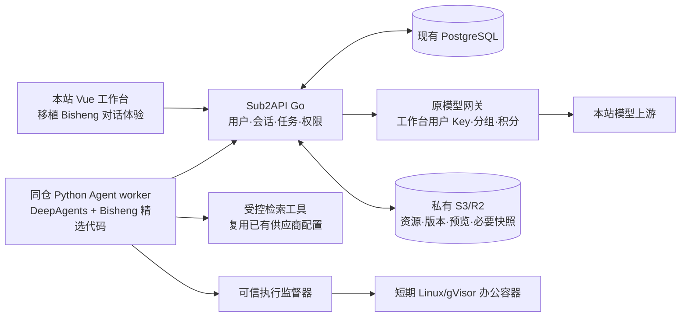

# 工作台对话助手：完整落地方案

日期：2026-11-19。分支：`codex/workbench-office-agent`。

本文是当前产品范围、前端移植标准和交付顺序的统一入口。技术细节见 [总体技术设计](WORKBENCH_OFFICE_AGENT_DESIGN.md)，已完成的代码和验证见 [实施记录](WORKBENCH_OFFICE_AGENT_IMPLEMENTATION.md)。本文更新原设计中前端移植的要求及过度串行的实施顺序；尚未完成的能力不因写入方案就视为已交付。

## 1. 最终目标

将个人工作台升级为三个入口：**对话助手、图片生成、我的文件**。对话助手作为主要入口，完成问答、查资料、处理文件、生成与修改办公文档。用户从本站进入、登录、消费积分、保存会话和取文件，全程沿用本站账号。

前端定位明确为：**Bisheng 对话与任务界面的 Vue 移植及本站适配**。Bisheng 的页面结构、信息层级、布局比例、消息排版、输入区、任务过程、文件成果面板和适用交互是设计底稿。React 组件要手工改写，但不能用一套另行设计的聊天页面代替。

保留本站“控制台 / 工作台”及“管理员 / 个人”的上下文切换。图片生成继续在原路径运行；对话功能开放后才调整工作台默认落点。新增功能关闭时，用户仍可正常进入图片生成。管理员进入工作台仍落在管理概览。

## 2. Bisheng 移植范围与保真标准

### 2.1 移植方法

以已审计的 `dataelement/bisheng@a8e5be89c1b8d3a2e512c772e2a38de409336dc8` 为固定源版本。后续有需要的上游修正单独评审，不边开发边跟随 main 改样式或协议。

| 对象 | 实施方式 | 验收重点 |
| --- | --- | --- |
| 会话页与空白首页 | 移植主聊天页面、欢迎区、历史侧栏与新建入口 | 内容宽度、首屏重心、留白与输入区位置 |
| 消息与输入区 | React 改 Vue，沿用原排版和适用操作 | Markdown、表格、代码、长消息、输入法、附件及停止状态 |
| 任务过程 | 移植 Linsight 任务卡、阶段/步骤、折叠与状态变化 | 不把任务过程改成简单转圈或一长串日志 |
| 澄清与排队 | 移植等待补充、排队和运行状态的呈现 | 状态真实；用户知道等什么、下一步做什么 |
| 成果与工作区 | 移植成果卡、文件列表、右侧预览、返回、全屏及适用引用对照 | 文件与对话是统一体验；切换不丢阅读位置 |
| 纯 TypeScript 逻辑 | 无框架依赖且语义相符的部分直接复用，保留测试和来源 | 步骤整理、折叠、引用、文件类型判断不重复发明 |
| React hooks/组件 | 改写为 Vue composables/组件，替换业务接口 | 不让 React 生命周期、Bisheng 全局状态进入本站 |
| 主题与基础控件 | 映射本站主题和组件，补必要的样式变体 | 复用控件不能把 Bisheng 的视觉层级改成默认表单样式 |

按当前活跃引用链确定来源，不仅按组件名称选择。以下路径相对 Bisheng `src/frontend/client/src/`，目标是迁移映射，尚未创建 Vue 页面：

| 页面部分 | 固定源组件 | 本站承接 |
| --- | --- | --- |
| 页面装配与首页 | `components/Chat/ChatView.tsx`、`Landing.tsx`、`ConvoStarter.tsx` | 对话页、欢迎区与会话切换 |
| 输入与模型 | `components/Chat/AiChatInput.tsx`、`Input/ComposerEditor.tsx`、`AttachmentBar.tsx`、`ChatResourceMenu.tsx` | Vue 输入组件与子组件 |
| 消息与标题 | `components/Chat/AiChatMessages.tsx`、`AiMessageBubble.tsx`、`HeaderTitle.tsx`、`Messages/Content/*` | 消息、Markdown、引用与操作 |
| 会话导航 | `layouts/WorkbenchSidebar/WorkbenchSidebar.tsx`、`SidebarConversationList.tsx`、`components/Conversations/Convo.tsx`、`ConvoOptions/*` | 本站单侧栏内的会话导航 |
| 任务过程 | `components/Linsight/Execution/TaskTurnPanel.tsx`、`ExecutionTimeline.tsx`、`DeepStepGroup.tsx`、`TaskStepRow.tsx`、`PinnedTaskPanel.tsx` | 消息内过程与输入框上方的任务清单 |
| 澄清与排队 | `components/Linsight/Execution/ClarifyCard.tsx`、`ClarifyFallbackCard.tsx`、`QueueCard.tsx` | 等待补充与排队状态 |
| 成果与预览 | `components/Linsight/Artifacts/ResultSection.tsx`、`WorkspacePanel.tsx`、`PreviewBody.tsx`、`SaveAsButton.tsx` | 成果链接、清单、右侧工作区与预览 |

集成对话优先移植 `TaskTurnPanel`，不再叠加独立 `ExecutionFlow` 页面容器。当前任务模式的活跃入口在 `ChatResourceMenu`；`TaskModeToggle`、`PlusMenu` 等旧组件不因名称相近就一并迁入。文件预览依赖原知识库目录不代表必须搬知识库，可抽取阅读器并替换资源接口。

模型选择保留在输入框右下角。`＋` 菜单保留“任务模式”，启用后出现可关闭的标记；普通对话与多步骤办公的区别对用户可见，不暗中将一次普通问答升级成高消费任务。任务清单默认折叠，位于输入框上方，展示当前步骤与完成进度。过程未收尾时不能因子任务已勾完就显示成功。

同一站点只保留一条工作台侧栏。通过工作台布局插槽容纳 Bisheng 的会话导航，避免在现有 220px 侧栏旁再叠一条永久导航。对话页使用专用内容布局，解决原 `AppLayout` 的大边距、固定顶栏和页面滚动与聊天布局冲突；不全局改变控制台、图片页和后台。

桌面成果区沿用右停靠面板，源宽度为 `clamp(440px,46%,720px)`；不超过 1023px 使用覆盖层/抽屉，不超过 576px 全屏，保留返回层级。不会未经对照就将其改成另一套“对话/文件”页面导航。源会话列表为平铺列表和无限滚动，不擅自加日期分组。本站侧栏 220px 与源 240px 的差异单独登记，在源页面对照后决定适配。

样式也是移植对象：同步迁移 `components/Chat/chat-surface.css`、`chat-controls.css`、适用的 `markdown.css`、主题 token 和断点。源输入框最终样式的 28px 圆角、柔和阴影，以及消息/输入内容宽度并不完全写在 TSX 类名中。CSS 约束到新模块和专用 Teleport 容器，不能将源项目的 body/Markdown 全局规则直接作用于本站。主题主要映射颜色和品牌，保留比例、密度、排版与动效节奏。

### 2.2 保真验收单独设门槛

先建立固定数据的原页面状态样本，再做 Vue 对照。至少包含：空白首页、多轮长对话、附件输入、任务运行、步骤折叠、等待补充、排队、失败/取消、单/多成果、预览/全屏、来源对照、历史恢复。

对照桌面、1023/767/576px 与手机宽度，检查浅/深主题、缩放、中文输入法和滚动。用户主动上滚应暂停自动跟随，回到底部恢复；加载历史不能闪回首页。预览单实例挂载，文件版本作为有界缓存键，不能在全屏切换时重复拉取文件。记录源组件、Vue 对应组件、源哈希、保留行为和差异原因。固定事件回放用于验收界面，真实 API 联调另行验收；不能把演示数据当成真实办公结果。

当前完成的是源码审计，尚未完成运行中的 Bisheng 源页面截图基准；M1 先补固定窗口尺寸的基准，不能仅凭读过源码就声称视觉一致。

第一批前端交付是上述核心场景可点击的 Vue 移植切片，仅开发/试验环境可见。先让设计可审阅，再接完整业务，不等办公算力全部就绪才开始还原界面。

### 2.3 本站适配与删减

登录、用户、模型、积分、资源、任务、主题和路由改接本站。去掉工作流画布、RAG/知识库选择、应用搭建、应用市场、租户管理和不在本期的集成。保留原布局中适用的工具选择与任务交互，只呈现本站真正开放的搜索和办公能力。

不增加完整在线 Office 编辑器、不运行整套 Bisheng 服务、不引入第二套 React 应用。许可证、版权、适用 NOTICE、来源和修改记录随代码保留；图标/插画/字体/模板分别核对可再分发范围。

## 3. 用户功能与使用路径

| 功能 | 首个完整版本的行为 |
| --- | --- |
| 基础对话 | 新建、历史、重命名、删除、模型选择、流式回复、复制、停止、明确发起的重新生成 |
| 任务模式 | 延续源输入区的显式开关；用于需要规划、工具和多步骤交付的请求，关闭时不偷偷启用整套办公 Agent |
| 持久会话 | 服务端保存，刷新/换设备可继续；本地只作草稿和展示缓存 |
| 长会话 | 按公开模型能力组装上下文；分页加载，必要摘要保留边界及其真实费用 |
| 联网 | 开关控制；来源可点开，检索失败具体说明；没有搜索配置就不声称已经联网 |
| 文件理解 | 选择上传文件或“我的文件”里的明确资源，提取结构和必要内容，回答带相应引用 |
| 办公生成 | DOCX/XLSX/PPTX 生成、检查、必要重算和渲染，成果卡预览/下载 |
| 继续修改 | 从指定旧版本生成新版本，旧答案/原件/旧文件保留；不覆盖原件 |
| 资料不足 | 在消息内呈现澄清卡；回答后恢复同一任务，等待时不占办公容器 |
| 用量 | 本轮可展开模型子调用、Token、实际费用和明确错误，未结算显示待结算 |

不首期增加任意 MCP、用户装插件、用户终端、电脑/浏览器控制、自动发邮件、跨会话记忆或团队协同编辑。

典型办公路径：上传销售表格 → 说明分析与报告要求 → 提取结构/统计/画图 → 生成 Word 和 PPT → 重开/重算/渲染检查 → 发布两个文件版本 → 右侧预览/下载 → 用户提出修改 → 引用上一版生成新版本。

## 4. 服务端如何融入本站

Go 唯一拥有用户、公开会话/任务状态、文件归属和积分。Python 负责图内推理和工具编排，使用短期 run 凭证，拿不到用户长期模型 Key；不可信办公容器连该短期模型凭证也没有。生成脚本只进隔离容器。

普通聊天路径保持轻量，不装载办公技能、不创建办公容器，也不为简单问题额外调模型做标题/规划。搜索按开关启用，多步骤办公按明确任务模式及允许能力启用；若普通对话提出需要办公工具的请求，给出进入任务模式的明确操作。文件解析本身如需运行工具，也经过受限执行环境；“普通聊天不占办公槽”指纯文本对话，而非允许在主站直接解析任意文件。一套会话与事件模型承载两类任务，不复制两套产品。

同仓运行器使用轻量对话/检索与办公任务两个执行预设、独立领取与并发池。轻量对话 worker 可与主站同机运行，不依赖办公算力机或监督器健康。办公排队、槽满或算力机离线时，普通对话仍可工作。服务端固化每个 run 的模式和允许工具，不能只在前端保存一个开关、由后端自行猜测。

## 5. 模型选择、协议与积分

全工作台复用现有配置分组和每用户系统工作台 Key。后台可将其文案升级为“工作台模型分组”，但保留原字段迁移兼容、Key ID 与历史 usage 关联，不新发第二把办公 Key。

模型目录只显示该分组真实可调用的**公开模型 ID**。官方参数和能力按该 ID/官方档案判断；自定义别名需要明确关联档案，不回溯实际供应商的拆分模型名重新定义语义。官方最大能力与管理员的任务预算分开显示和保存。

复用已有官方能力档案与远端更新基础，提供上下文、输出上限、推理参数、视觉及工具支持。用户看到的参数以所选模型为准。未知模型可保守开放已确认的文本能力，但不凭名称猜测它支持全部 Agent 工具。

当前内部 pilot 使用 Chat Completions 文本桥且先缓冲完成结果；它不等于最终已支持各供应商实时流式/视觉/工具。正式接入要按本站可用模型验证 OpenAI、DeepSeek、Claude、Gemini、Grok 的文本、工具、流式和 usage 语义；协议转换走原网关/RelayKit，不在 Python 再造转换层。模型切换应用于下一次 run，运行中不偷偷换价或换模型。

每次实际模型请求经过原鉴权、余额准入、调度、usage 和积分账本。任务页只聚合这些实际记录，不在任务结束再扣一次总费。搜索供应商次数/成本单独统计；如需向用户收费，必须另有明确费率，不伪装成模型 Token。

任务次数、输出、时长、并发与消费预算限制后续步骤；在途/晚到用量仍按实际结算。网关掌管安全重试与故障切换，Agent/SDK 不再乘法重试。没有经过实际调用验证的模型能力不标成已支持。

## 6. 会话、运行、恢复与流式

会话与消息持久保存；一次发送创建一个 run，内部模型/办公操作分别登记。浏览器刷新只补读和重连，不能再创建同一次任务；重新生成是用户明确的新请求，保留旧结果。

重新生成需要记录明确的上下文边界与候选答案：对同一用户问题产生新的候选答案，保留旧答案，只有选中的答案进入后续上下文。失败/取消的残留、工具内部消息与非选中候选不能简单按时间拼入下一轮。首期不做完整分支树，但须在 M2 前冻结此契约，避免以后重做会话结构。

当前 pilot 故意限制每用户只有一个未结束任务。正式 M2 应改为单会话单活动 run，并分别实施每用户普通对话/办公的限额与队列。办公排队、等待补充或结果未确认不能无限锁住用户其他会话；未知 operation 仍禁止重发，用户可以明确结束该任务后发起新请求。

真实流式按小批片段持久后分发，事件有顺序和稳定身份；重连从最后序号补读，过期则取任务快照。显示过的文字/公开步骤可恢复，不能把模型未完成或连接中断包装成成功。公开步骤表示正在做的动作，不直接泄漏内部推理、完整工具原始日志、密钥或宿主路径。

Go 管理排队、运行、等待用户、完成、部分完成、失败、取消及结果未确认。LangGraph 检查点持久化到同一 PostgreSQL 的独立 schema，配最小权限角色；在每次写入校验租约/epoch，并与 Go 操作 inbox 对账。仅有数据库 saver 不算恢复完成。

已派发但结果未确认的调用不会盲目重放；错误明确说明哪一步、是否可能产生费用、接下来可做什么。等待用户前保存必要快照；收到同一澄清回复的重复提交只恢复一次。取消撤销新操作权限并停止工具；晚到结果只保存用于对账，不复活任务。

关闭“发起新对话/办公”开关应停止新任务准入，已保存历史和文件保留可读；正在运行的任务采用明确的排空或取消动作。用户停权、资源删除等仍按原权限策略处理，不能因历史模式绕过授权。

## 7. 我的文件、旧图库与存储

**统一用户资源入口，先不物理合并旧图库。** 我的文件显示上传原件、生成文档、不可变版本及旧云端图库图片；旧图片不搬对象、不复制计费、不改原图片历史。选择旧图会登记跨模块保留引用，删除原生图任务不能误删对话正在使用的图。

新资源使用通用元数据，不把 Word/Excel 塞进图片表。用户隔离由服务端所有权/版本授权实现，不需要每用户一桶。私有对象存储优先复用现有 S3/R2 连接；办公使用独立前缀。若图片桶的生命周期会误删长期文件，则复用连接凭据、单独选办公桶。不能复用 MiloCode 公开软件下载桶。

后台将办公用途纳入存储目标变更保护、私有性校验、容量与清理；不能让“关闭图库”同时断掉办公文件。浏览器按授权取得短期链接，适用时直接从 R2 取文件，减少主站原文件下载带宽。私有签名仍可在有效期内重复请求，方案不承诺签名天然一次性或不存在刷流量风险。

| 数据 | 存放位置 | 生命周期 |
| --- | --- | --- |
| 会话、任务、资源归属、文件版本与用量关联 | PostgreSQL | 按业务保留与删除策略 |
| 原件、交付版本、预览 | 私有 S3/R2 | 计容量；明确删除或到期才清理 |
| 当前脚本临时文件 | 有硬配额的隔离工作区 | 任务/工具结束回收 |
| 等待用户/恢复所必需的工作快照 | 独立 staging 前缀 | 被恢复引用时保留；不再需要后按 TTL 回收 |
| 浏览器草稿与预览缓存 | 浏览器 | 性能辅助；退出账号清理，不作唯一数据源 |

列表只取缩略图与元数据；预览按需取 PDF/页图/分页表格，下载才拿原件。预览结果按不可变版本缓存，不因切换面板反复转换。图片继续复用现有 thumb/preview/original。XLSX 大表不能整张加载进 DOM；首次不在线执行宏、HTML 或任意脚本。

上传/版本/衍生物都计入配额，失败释放预留。活动任务固定所用版本，删除资源采用先逻辑删除、再受引用保护的物理清理。删除会话默认删除会话引用，文件由“我的文件”单独管理；不能反过来意外删除原始资料。

## 8. 办公算力与正确性

独立 Linux 算力机承载可信 worker/监督器及临时容器是推荐部署方式；与主站通过受信私网或加密认证连接。仍属同仓内部组件，只有一套账号、数据库业务主干和计费。普通聊天、搜索和前端开发不以先准备此机器为前提。

模型运算仍调用本站上游，文档解析和渲染本身不要求 GPU。初次验收先一个办公槽，根据真实样本测 CPU/内存/磁盘再扩，不按“用户数”等同“虚拟机数”采购。硬件建议以现有环境兼容验证和实测为准。

短期执行容器固定镜像、固定预装库、无外网、无平台凭据、非 root；CPU、内存、PID、时间和临时盘均受限。没有 runsc 则拒绝办公执行，不降级在主站/普通共享容器跑模型代码。可信监督器持有 Docker 控制权限，需与普通用户任务严格隔开。

当前 pilot 是每次办公工具操作运行短期容器，通过有界快照接续同一任务文件；RAM 快照只是试验实现。后续通过授权资源和必要 staging 快照持久恢复，不对每次中间文件读写请求 R2，也不为每个用户保持常驻容器。

| 成果 | 发布前的验证 |
| --- | --- |
| Word | 重开、章节/表格与必要内容检查、渲染分页和明显溢出 |
| Excel | 重开、公式重算、错误单元格和关键统计校验 |
| PPT | 重开、页数/内容、页图渲染、明显裁切和字体问题 |
| PDF | 页数/文字提取、必要页面渲染；扫描件 OCR 首期另评估 |

只有选定模型具备视觉能力且真的看过页图，才可声称模型做过视觉检查。文件生成成功、验证成功、归档成功是三个步骤，最终可下载必须以归档和引用登记成功为准。允许有限修复，失败具体说明，部分成果明确标记部分完成。

## 9. 搜索与后台管理

复用已有 Brave/Tavily 配置和底层搜索适配，增加适合 Agent 的受控检索/网页读取及来源映射。它不等同于现有单搜索工具模拟。对外网页抓取校验协议、解析 IP、重定向、类型、大小和时间；不允许请求内网或云元数据。上传文件和网页都只是资料，不拥有授予工具/权限的能力。

管理员工作台沿既有壳扩展：

| 页面 | 增加内容 |
| --- | --- |
| 概览 | 对话/图片用量、任务/排队、失败、资源容量和执行器健康 |
| 任务记录 | 类型筛选；复用姓名/邮箱/昵称用户搜索；展开每次模型调用的上游、耗时、Token、费用及工具错误 |
| 用户资源 | 元数据、版本和用量；文档内容访问需明确权限并记审计 |
| 工作台设置 | 同一模型分组；对话/搜索/办公开关；私有存储引用；用户与任务配额 |

本站管理端采用已有组件与表格交互，Bisheng 管理控制台不移植。部署地址、认证、镜像与主机硬上限放部署配置；不让后台输入任意 shell/宿主路径/工具地址。现有面板 RPM 保护入口，任务内部另有共享次数/并发/时长/消费边界。

## 10. 实施顺序与可验收交付

采用两条并行轨：**对话产品与 Vue 保真移植**、**办公持久能力与隔离验证**。共享控制面、模型桥、会话和资源协议；不复制实现。界面可在开发环境先验收，办公未通过时不对普通用户呈现可执行按钮。

| 里程碑 | 主要工作 | 完成标准 |
| --- | --- | --- |
| M0 基础收尾 | 当前代码静态检查、契约及回归；冻结源组件/事件/资源/上下文/模式协议 | CI 完整通过；已做未做清晰；默认关闭 |
| M1 Bisheng Vue 移植切片 | 主聊天/历史/输入/消息/过程/成果/窄屏状态；可回放固定事件 | 对照源页面的外观与操作验收；没有叠加侧栏或通用表单替代任务体验 |
| M2 真正可用的云端对话 | 公开模型目录/档案、用户 API、持久会话、真实流式、上下文候选、停止/重连、用量和必要管理；解除 pilot 的全用户单任务硬限 | 多模型真实请求核对；刷新不重发、跨用户不可读、费用不重复；办公等待不挡其他会话，办公机离线不挡纯文本聊天 |
| M3 受控搜索 | 搜索配置复用、来源/引用展示、抓取限制及次数统计 | 查资料真实可用、引用可追踪、无伪造“已联网” |
| M4A 办公持久基础（与 M1–M3 并行） | 资源/版本/预览、staging、持久检查点与租约校验、旧图引用保留 | 故障恢复不重复模型操作；原件不覆盖；被引用的旧图不误删 |
| M4B 真实隔离验收（与前端并行） | Linux/gVisor、固定 Office 镜像、三类文件样本、限额和清理 | 真实隔离/渲染/重算通过；记录资源峰值、耗时与兼容边界 |
| M5 完整办公闭环 | 输入→生成/修改→验证→归档→预览下载→继续修改；澄清暂停恢复 | 文件跨设备可用；中断/取消不复活；成果有版本且归档后才显示交付 |
| M6 小流量开放与发布 | 完整后台、权限/配额、压测、故障演练及原模块回归 | 图片/API/积分/MiloCode/工单不受损；功能可分别停用；有发布及回退记录 |

M1 不依赖办公机器；M2 不依赖 Office 镜像或文件归档。M5 依赖 M4A/M4B，不能仅凭 mock 工具返回就开放办公。M2/M3 的对话开关与 M5 办公开关分别验收；部署与向用户开放也分开。

每个里程碑使用独立可评审提交，持续在当前功能分支推进。功能发布沿现有 fork 发版/镜像/生产验证流程，先对少量用户开放再扩大；不会仅因代码合并就自动启用新能力。数据库新增采用增量迁移，关闭时保留数据，不以删表/删桶做回退。

## 11. 当前真实进度

基线提交 `cf61227dc` 已提交并推送，生产尚未部署该功能。已实现：默认关闭的管理员试验 API、六张独立控制面表、原模型网关桥、操作防重放/租约/取消/事件、真实 DeepAgents 内核、三套 Bisheng 办公技能，以及受限执行监督器/镜像定义/探针。

已验证：本地 Go 整包回归与定向 race、11 项真实 PostgreSQL 测试、24 项 Agent 测试、28 项执行器测试，以及真实 Python 子进程经 Go 模型桥完成对话。后者的上游回复为 fixture，不能充当真实上游计费验收。

复核 GitHub 后，基线的前端、单元/集成、office-agent-pilot 和安全扫描通过；CI 整体因 Go 静态检查失败，shell job 取消。静态问题包括新增代码的 Rollback/Close 错误处理、测试类型断言和未使用包装函数，已在 M0 收尾修正并通过格式/差异检查，完整结果以远端复跑为准，不能称为完整 CI 全绿。

尚未完成：Vue 对话界面、多供应商真实流式/工具/费用验收、持久图恢复、通用资源与 R2 归档、联网工具、真实 Linux/gVisor 与 Office 渲染、普通用户和完整管理端开放。

紧接着的工作是 M0 收尾与 M1 前端源组件/状态样本移植，同时推进模型/事件协议和办公恢复/资源契约；先把 Bisheng 的完成度变成可对照的交付标准。
